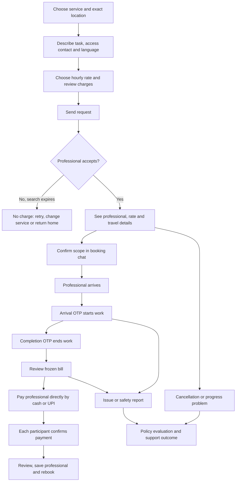
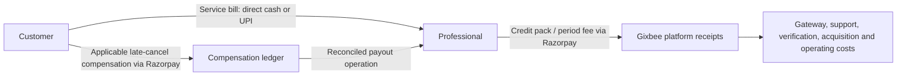

# Gixbee: business and product flow

Working blueprint • 9 September 2026 • One Indian city, Instant Help first

This defines the business, user journeys, operating responsibilities and build sequence. It combines a static review of the repository with public competitor product/help pages. It is not a report of live production testing or hands-on competitor account testing. Prices described as existing are code defaults, not verified live configuration. New commercial suggestions are proposals, not published terms.

## 1. The business

**Gixbee helps households find nearby independent professionals for clearly described local tasks, and helps those professionals build repeat local work.** Its first market is a small service area inside one city. Supply coverage determines opening hours and available categories.

One person can be a customer, a professional, a job seeker and a business owner. Keep one account with optional profiles. Each transaction needs its own fulfillment process: an electrician visit, a permanent hire, an event quotation and a camera rental cannot share identical deadlines or payment rules.

Launch Instant Help in two or three adjacent neighborhoods and a small number of repeatable categories. Choose the city and categories using available verified supply, realistic travel times and observed customer demand. The repository does not establish which city has sufficient supply; do not choose one from a hardcoded map fallback. Start with defined household tasks. Add categories requiring specialist credentials or special operating procedures only when those are supported.

| Participant | Receives | Gives Gixbee |
| --- | --- | --- |
| Customer | A clear request, professional acceptance, progress, bill and support record | Demand, service feedback and repeat bookings |
| Independent professional | Suitable nearby requests, booking records and repeat customers | Verified service capability, availability, fulfillment; platform access fees |
| City operations | Tools to maintain supply, handle exceptions and reconcile platform receipts | Verification, service standards and resolution of cases |
| Future employer/vendor/rental owner | A separate demand and fulfillment channel | Listings, timely responses and the applicable platform fee |

The core measure is **completed, mutually payment-confirmed jobs per active service area**, alongside customer repeat use, professional earnings after costs and unresolved disputes. GMV (the value customers pay professionals) is not Gixbee revenue.

## 2. What comparable products teach us

| Source inspected | Useful product pattern | Gixbee application |
| --- | --- | --- |
| [Urban Company InstaHelp](https://www.urbancompany.com/mumbai-insta-help) | A named local service proposition and a dedicated booking entry point | Describe the available task and scope; show actual local availability. Do not copy an arrival-time promise without measured coverage. |
| [Taskrabbit: after booking](https://www.taskrabbit.com/blog/getting-started-with-taskrabbit-what-happens-after-i-book/) | The professional confirms suitability, discusses tools/access/scope and agrees scheduling | A request is not fulfillment. Show the agreed rate and use booking chat to confirm scope before work begins. |
| [Apna: posting with credits](https://employer-help-centre.apna.co/support/solutions/articles/1060000120707-how-do-i-post-a-job-with-credits-) | Structured role, location, compensation, requirements, interview details, preview and payment | Employer quality starts before candidate matching. Keep employer and candidate outcomes visible through joining. |
| [WedMeGood vendor terms](https://www.wedmegood.com/terms_vendor) | A vendor relationship and paid premium membership distinct from an individual event | Treat vendor discovery and an event contract as separate steps. Any Gixbee vendor subscription is a future proposal. |
| [Hygglo: how it works](https://help.hygglo.info/en/articles/10415333-how-hygglo-works) | Availability, owner approval, verification, handover, return and reviews | A rental requires inventory and condition control, not an Instant Help acceptance timer. |

Competitor payment models are not interchangeable. [Taskrabbit's payment help](https://support.taskrabbit.com/hc/en-ca/articles/46260427597595-How-Do-I-Pay-My-Tasker) describes payment through its platform; Gixbee currently uses direct customer-to-professional cash/UPI settlement. Do not imply that Gixbee holds service money, offers escrow or provides another platform's insurance or guarantees.

## 3. First-city acquisition and activation

1. City lead recruits professionals through local trade networks and direct field onboarding. Record category, working area, languages, availability, tools and indicative rate. Pre-launch community structure, WhatsApp cells, waitlist fields and the 10-week sequence are in [PRELAUNCH_WORKER_COMMUNITY.md](./PRELAUNCH_WORKER_COMMUNITY.md). Density in the launch polygon matters more than a national follower count.
2. Verification operations check identity and category capability, explain charges and cancellation rules, and resolve rejected or incomplete applications. Identity verification alone is not a skill certificate.
3. Run supervised test bookings with consenting pilot participants. Check location, notification delivery, OTP handoff, bill and both payment confirmations.
4. Open only the areas/categories that can fulfill requests during staffed operating hours. Use local community partnerships and referrals after successful jobs; keep acquisition channels attributable.
5. Review demand missed, response time, travel cost, earnings and support cases daily. Recruit supply for a demonstrated coverage gap before increasing paid demand.

No automatic customer notifications, marketing campaigns or account outreach are authorized by this document. Campaign execution is a separate operating action. The pre-launch worker playbook is operating guidance for city supply leads; it still does not authorize bulk SMS, paid demand ads, or customer push.

## 4. Customer journey: discovery to repeat use

| Step | Customer sees/does | Professional/system responsibility | Completion evidence |
| --- | --- | --- | --- |
| Discover | Available categories for the chosen location; honest empty state | Eligible, verified live supply; no invented pro count | Exact location and category |
| Describe | Issues, note, property/access details, language; who is present | Receive the same request details | Saved task description and onsite contact |
| Price | One payable hourly rate, one-hour minimum, elapsed-minute billing thereafter, travel explanation and direct-payment method | Accept the offered rate; no undisclosed rate substitution | Booking amount is the offered hourly rate |
| Review | Service, address, scope, contact, language, rate, payment and cancellation summary | Do not broadcast before final confirmation | Explicit request action |
| Search | Searching state and real elapsed search; cancel while unassigned | Notify eligible professionals; first valid acceptance wins transactionally | Booking ID, notification targets and acceptance |
| Accepted | Professional identity, progress, travel details and contact channel | Review task, communicate tools/materials/access constraints | Accepted timestamp and location snapshot |
| Arrived | Confirm the correct professional is present; share arrival OTP | Mark arrival and enter OTP | ACTIVE and startedAt |
| Work | Clock represents elapsed work time; scope agreed in chat | Work within scope. Ask before additional materials/work; do not silently modify the agreed hourly rate | Booking chat and progress |
| Complete | Inspect work and use completion confirmation; view itemized bill | Stop work timer and show service/travel components | COMPLETED and frozen billing fields |
| Pay | Pay the professional directly, then confirm cash/UPI | Independently confirm receipt | Both flags true; isPaid true |
| Retain | Rate, favorite and book again; report a problem from the booking | Maintain history and resolve cases | Rating/favorite or linked dispute |

Arrival and completion OTPs have different meanings. Arrival starts billing. Completion ends work; it does not prove money was received. An onsite contact does not become the account owner or automatically gain access to the customer's account. Do not promise SMS delivery to an onsite contact unless that path is implemented and tested; the booking owner must coordinate the code with the person present.

### Pricing contract for the launch

- The request has one offered hourly rate. The current range input submits its upper value; show that exact payable value in the review, or replace the range with a single-rate input.
- Service charge = round(hourly rate × max(60, elapsed rounded work minutes) / 60). No pause/resume billing.
- Instant Help adds a one-way travel charge based on recorded acceptance distance and configured per-km rate (default ₹10/km). Distance is straight-line in current code, not road distance. Missing acceptance distance means no travel charge. Do not display a fabricated final travel quote before a professional accepts.
- Example only: ₹200/hour, 90 billed minutes and 2 km at ₹10/km produces ₹300 service + ₹20 travel = ₹320 paid directly to the professional. Materials are not included in this calculation.
- Explain exclusions before request and reconfirm them in chat before arrival OTP. Materials and additional scope need customer agreement. The current product has no structured change-order ledger: record agreement in booking chat and do not represent external material purchases as platform-collected charges.
- New acceptances now freeze the travel rate and quote. Completion uses that rate even if configuration changes during work; legacy jobs without a snapshot use the configured fallback. Validate this against the deployed database before launch.

## 5. Professional journey

Register/login → create professional profile → add skills, languages, location/radius and tools → identity/capability review → read access charges → obtain credits if required → Go Live → review an offer → accept explicitly → travel → arrive/OTP → perform task → completion/OTP → collect directly → confirm received → review customer → return to availability or go offline.

The dashboard should answer: Am I verified? Am I online? Where will I receive requests? What does acceptance cost? How many jobs can my current credit balance fund? Is a period fee due? What job or payment confirmation needs attention?

Worker credits are access units, not cash or job-value earnings. Credit packs now display both credits and the number of accepts supported at the current per-accept cost. New packs cost ₹49 and contain three times the current acceptance cost: 45 credits at the default 15 credits/accept. This reconciles the former three-jobs label with the actual debit. The order snapshots purchased credits; existing balances are unchanged. Future acceptance-cost changes can change how many accepts a remaining credit balance funds, so communicate such changes before applying them.

Existing code also charges a separate period fee after a configured number of jobs. Explain both charges together. Proposed commercial simplification: test one access model after measuring professional earnings and acquisition costs. Do not quietly add a commission or remove a fee in code without recording the changed commercial contract.

## 6. Exceptions and resolution ownership

| Situation | User outcome | Operations/system action |
| --- | --- | --- |
| No eligible professional or nobody accepts | No service charge; retry/change service/home | Expire the request durably, clear pending offers; record unmet demand |
| Two professionals accept simultaneously | One professional assigned | Lock booking and debit credits in the same transaction; loser gets clear already-taken response |
| Customer cancels REQUESTED or within accepted grace | Free cancellation under current rules | Record reason and refund applicable acceptance credits once |
| Customer cancels after grace, before arrival | Show mutual cancellation/late-cancel path and consequences | Evaluate current policy, record strikes with appeal; no hidden deductions |
| Professional makes no GPS progress | Eligible free-cancel option when policy condition is met | Preserve progress evidence; avoid punishing missing GPS as proven misconduct without review |
| Professional cannot fulfill/no-show | Customer gets an explicit resolution and retry path | Record cause; apply applicable credit/strike policy; support can correct wrongful strikes |
| Work started or professional arrived | Issue/support path rather than a misleading free-cancel action | Mediate stop-work, incomplete work and direct-payment dispute; retain evidence |
| Customer says paid, professional disagrees | Show waiting/disputed payment, not automatically paid | Review both statements and any receipt supplied; Gixbee cannot automatically refund service money it did not collect |
| Razorpay debited but app closes | Purchase recoverable after reopen | Signed captured-payment webhook fulfills once; verify stored order ownership and amount; ledger supports reconciliation |
| Duplicate callback/webhook | One purchase credit | Lock order and atomically write credit, transaction receipt and fulfillment status |
| App disconnects/restarts | Resume the same booking | Server state authoritative; socket/FCM plus existing status fallback |
| Server restarts mid-search/deadline | Request still expires or progresses | Durable job schedule/reconciliation; in-memory sleeps alone are insufficient |
| Complaint or safety concern | Accessible report path and visible case status | Human owner, severity, evidence, outcome and follow-up; do not advertise emergency response the team cannot provide |

Current cancellation rules: free while REQUESTED or within three minutes after acceptance; later mutual-cancel request or a late-cancel strike; no unilateral customer cancellation after ARRIVED/ACTIVE; qualifying worker non-progress unlocks free cancellation. Three late-cancel strikes block Instant Help until distance-based compensation is paid. These existing rules must be explained before request and reviewed for fairness using pilot cases.

## 7. Money and unit economics

Keep three records separate: service bill, platform payment order, and compensation liability/payout. Wallet settlement remains disabled. Payment confirmation does not authorize pulling money from either participant.

| Measure | Definition |
| --- | --- |
| Service GMV | Sum of completed service bills; report unpaid/disputed amounts separately |
| Platform cash collected | Captured platform payment orders less actual platform refunds |
| Earned access revenue | Access revenue recognized under the chosen accounting policy; unused packs are not automatically revenue earned on a job |
| Contribution per completed job | Allocated earned platform revenue minus gateway cost, variable support, verification allocation, incentives and platform-funded losses |
| Professional net earnings | Direct service income minus travel/materials and platform access charges; distinguish time online from time working |
| Customer acquisition payback | Acquisition spend / contribution from the acquired cohort; use repeat behavior, not an assumed lifetime value |

Illustrative scenario, not a forecast: 100 completed jobs × ₹300 average bill = ₹30,000 GMV. If allocated earned platform revenue is ₹20/job and variable operating cost is ₹12/job, contribution before acquisition/fixed costs is ₹800. An additional ₹1,000 acquisition spend makes that cohort contribution −₹200. Revenue can increase while the business still loses money; measure the full flow.

Daily reconciliation: captured provider payments ↔ stored orders ↔ credit transactions; completed bookings ↔ direct-payment confirmations; compensation collected ↔ worker payout liability ↔ completed payout references. Never use an app success toast as settlement evidence. Razorpay recommends API verification for immediate confirmation alongside webhooks; see [official integration steps](https://razorpay.com/docs/payments/payment-gateway/web-integration/standard/integration-steps/?preferred-country=IN) and [payment webhook events](https://razorpay.com/docs/webhooks/payments/).

## 8. City operations

| Owner | Daily queue | Required outcome |
| --- | --- | --- |
| Supply lead | Pending professional verification, active coverage, declined/missed offers | Verified supply schedule and category coverage |
| Support lead | No-shows, active-job issues, unpaid confirmations, strikes/appeals | Named case owner and reasoned resolution visible to participants |
| Finance operator | Unfulfilled captured payments, duplicate receipts, compensation liabilities | Reconciled order/credit/payout trail; actual refund reference where applicable |
| Product/city lead | Request-to-accept, accept-to-complete, repeats, earnings, cost per job | Expand, recruit supply, adjust hours or pause a poorly performing area |

Proposed pilot targets are internal gates, not customer promises: monitor time to acceptance and arrival at median and 90th percentile, fulfillment rate, support cases per 100 jobs, payment-confirmation lag, repeat rate and professional net earnings. Establish baselines during the pilot before setting numerical service guarantees. Expansion requires stable coverage, recoverable payments and staffed exception handling, not only a download target.

## 9. Expansion flows

### Local hiring

Employer identity → verified HIRING business → role, salary range, employment type, location, skills, vacancies and interview details → preview and fee quote → platform payment/eligible hiring credit → matching window → candidate sees relevant alert → candidate expresses interest and permits contact → employer shortlist → interview → offer → candidate acceptance → joined/closed/rejected → feedback and repeat hiring.

Candidate: basic profile → reusable career preferences → matching alerts or board search → interested/apply → application status → interview → offer decision → joining confirmation. Show classic applications and Smart Hiring status together where useful while retaining their distinct data models.

Current Smart Hiring checks interested candidates against vacancies at the end of its 24-hour matching window. It does **not guarantee a completed hire**. If the implemented guarantee fails, offer the recorded hiring-credit/refund choice. Credit belongs to hiringCreditBalance, not the dormant wallet. Candidate identity/contact should be shared through explicit application/interest consent. Core job seeking should remain easy to access; review the optional paid extra-profile model before expansion.

### Event services

Customer event date/location/guest count/budget → shortlist vendors → enquiry → vendor availability → itemized, versioned quote (scope, exclusions, deliverables, travel, taxes where applicable, milestones, cancellation terms) → customer acceptance → agreed direct vendor advance → date confirmation → preparation reminders → event → deliverables accepted → direct balance payment → dual receipt confirmation → review/support.

Vendor: verified SERVICE business → portfolio/packages/coverage/calendar → enquiry inbox → quote → confirmation → blocked calendar → fulfillment → payment and deliverable follow-up. Use event-date deadlines and explicit rescheduling; do not expire an event enquiry after a 90-second instant-job timer. Advance records and signed scope need implementation before promoting this as a complete event-booking service.

### Rentals

Owner verified → item details/photos/condition, rates, availability and handover rules → renter selects item and exact interval → overlap check → owner approves → identity and agreed deposit/payment terms → confirmed reservation → both record handover condition and included accessories → ACTIVE → approved extension with overlap/price recheck if needed → return and condition check → final direct settlement/deposit resolution → COMPLETED → review/dispute.

Current reservation lifecycle and overlap locking provide a base. Condition evidence, deposit ownership/refund rules, damage handling, overdue items and extensions require explicit implementation. Do not advertise insurance, automatic deposits or damage cover that does not exist. Rental duration pricing is its own contract; do not import a competitor's day definition.

## 10. Implementation map and launch gates

| Area | Existing code | Required completion/verification |
| --- | --- | --- |
| Customer Instant Help | Flutter instant request/search/tracking/OTP/payment/rating screens | Clear single-rate offer and final review; honest unavailable state; verify complete device flow |
| Credit purchase | Nest real order call; Rust placeholder order and verification; inconsistent pack/history contracts | Persist purchase entitlement, real order and captured-payment verification, atomic webhook recovery; identical client contracts |
| Direct settlement | Both participant flags and isPaid | Transactional read/lock/update/outbox so simultaneous confirmations cannot overwrite each other |
| Identity/authorization | Nest KYC integration; Rust verification and some non-instant routes incomplete | Fail closed until genuine verification; complete role/ownership checks before enabling affected journeys |
| Notifications/deadlines | PostgreSQL outbox, Redis/socket/FCM, Nest Bull; Rust in-memory delayed jobs | Recover expiry/progress after restart; idempotent delivery and proper claims; test replica behavior |
| Pricing | Existing completion formula and travel fields | Disclose before request; freeze agreed inputs; verify bill at boundaries |
| Operations | Admin verification, bookings, disputes, strikes, support pages | Confirm production runtime supports every required admin action and records resolution |
| Market configuration | City/master-entry management and location selection | Pick actual launch city/areas/categories/hours using verified supply; configure and dry-run before opening |

Keep PostgreSQL as transaction authority, Redis for presence/realtime and a durable job worker for deadlines. Kafka is not required for this first-city workflow. Add streaming infrastructure only for demonstrated retained replay/multiple-consumer needs.

### Acceptance scenarios before paid launch

1. New customer requests a defined task at a confirmed pin; backs up and edits rate/address; final review matches saved booking.
2. Unverified/offline/ineligible professional cannot accept; two eligible professionals race and only one wins/one debit occurs.
3. Search expires, customer cancels during search and worker accepts near expiry: no orphan or double assignment.
4. Arrival OTP starts time, completion OTP closes it; one-hour minimum and elapsed-minute/travel rounding match displayed bill.
5. Customer and professional confirm cash/UPI simultaneously; both flags and payment event survive; third parties are rejected.
6. Credit purchase: successful capture, bad signature, wrong owner/order/amount/currency, authorized-but-not-captured, duplicate callback/webhook and app closed after payment.
7. Restart API/worker during search, accepted progress check and payment delivery; jobs recover and money is credited once.
8. Cancel/no-show/late-cancel/appeal and direct-payment dispute each have a reachable screen and admin resolution path.
9. A real test-device notification resumes the correct booking with masked contacts and participant-only access.
10. Reconcile pilot receipts, worker earnings and support cases; expand only after unresolved launch blockers are closed.

Implementation and validation results are recorded in `GIXBEE_IMPLEMENTATION_STATUS.md`. This blueprint does not certify the live service as launch-ready.
