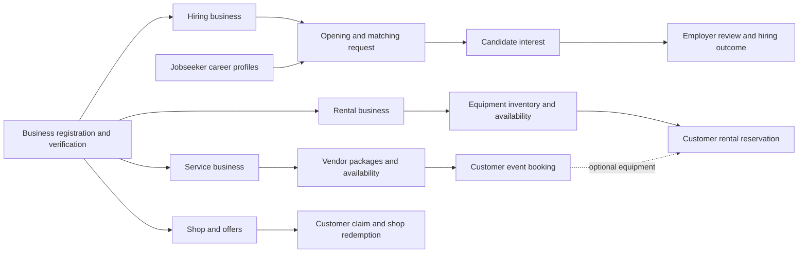

# Gixbee v147: four-flow review

Reviewed 9 September 2026. Source: [Gixbee_v147 (3).html](</C:/Users/gkv00/Downloads/Gixbee_v147%20(3).html>), including the embedded `job`, `lmb`, and `pa` documents and their JavaScript navigation/action handlers. Compared with the current Flutter, Nest, and Rust source.

This is a source-based flow study, not a live-user or browser walkthrough. Prototype screens, sample prices, verification badges, counts, and deadlines describe proposed behavior; they are not evidence that the corresponding service exists. Instructions and comments inside the supplied HTML were treated as document content. No application code, commercial configuration, or production data was changed for this review.

The prototype uses Thrissur/Kerala examples for businesses and events and all-India matching language for careers. These examples do not select the pilot city or override the previously chosen one-city launch scope.

## How the four flows connect

Gixbee for Business is the supply and employer side of the other journeys. In this prototype its embedded title is **List My Business**. It includes Service, Rental, Shops & Services, and Hiring businesses.

The HTML demonstrates both sides through local screen state and sample records. It does not establish a shared server transaction between a customer request and a business dashboard. For example, `pa.confirmRequest()` opens the hold screen, `pa.sendRentalRequest()` opens a success screen, and `lmb.completeVerify()` changes a local business object.

## 1. Find a Job

### Prototype journey

1. **My career profiles:** see active profiles, alert counts, salary, location, profile completeness, edit/delete, and free-slot usage.
2. **Choose a job:** career category and role; full-time, part-time, internship, or contract. The role/category is described as fixed after creation.
3. **Skills and background:** skills, experience, education, optional resume, and role-specific information such as trade certificates, licence, shift, cuisine, or references.
4. **Salary and location:** pay expectations and negotiability; joining availability; work mode; city/district/pincode; travel radius, relocation and languages. Internship and contract selections change the expected pay/details UI.
5. **Activate profile:** matching begins and alerts arrive for compatible openings.
6. **Review an alert:** employer, role, pay, requirements, vacancies and an explanation of the match. Interested, Later, and Skip are distinct choices in the design.
7. **Consent to share:** candidate expresses interest; employer receives a profile summary/resume. A later screen says the phone remains locked until shortlisting.
8. **Track progress:** shared → viewed → shortlisted → interview → decision. Interview details and employer chat appear in the prototype. Rejection has a reason.
9. **Maintain preferences:** edit skills/pay/location, pause alerts or change visibility, remove a profile, or upgrade.

Prototype navigation: Profiles / Alerts / Status / Settings. Screen identifiers: `home`, `cat`, `skills`, `salary`, `done`, `alerts`, `alert-detail`, `interested`, `status`, `status-detail`, `edit`, `subscribe`, `no-alerts`.

### Current code

- Flutter instead has **Board / Alerts / Profiles / Apps**. Board applications and Smart Hiring interests use separate APIs and trackers. The initial completion gate reads the classic TalentProfile, so a user entering Smart Hiring can first encounter a different profile wizard. See [FindJobModule](/C:/Users/gkv00/Music/gixbee/lib/features/jobs/find_job_module.dart:41).
- Nest implements career preferences, two free profiles, extra-profile purchase, immutable job type, a seven-day deletion restriction, matching, candidate interest and employer decisions. See [MatchingService](/C:/Users/gkv00/Music/gixbee/backend/src/hiring/matching/matching.service.ts:51).
- Matching currently uses role text, experience, salary, employment type, a free-text location substring and skill overlap. The profile/matcher contract does not implement the prototype's complete district/pincode/radius, work-mode, language, licence and role-specific eligibility model. A resume on the classic application is not automatically a resume on a Smart Hiring preference.
- Nest's Smart Hiring request detail only lists interested candidates and reveals phone after SHORTLISTED or HIRED. It does not return the prototype's complete candidate resume/interview/reputation view. [Contact handling](/C:/Users/gkv00/Music/gixbee/backend/src/hiring/matching/matching.service.ts:788).
- Smart Hiring decisions are PENDING, SHORTLISTED, REJECTED and HIRED. The classic application has an INTERVIEW status, but neither that enum nor the Smart Hiring model supplies the complete interview appointment, offer acceptance and confirmed joining journey. [Smart Hiring model](/C:/Users/gkv00/Music/gixbee/backend/src/hiring/matching/hiring-interest.entity.ts), [classic application model](/C:/Users/gkv00/Music/gixbee/backend/src/hiring/job-application.entity.ts).

### Decisions and gaps

| Topic | Difference to resolve |
| --- | --- |
| Candidate pricing | Prototype: two free profiles, ₹299/month unlimited or ₹597 quarterly, plus a trial. Current Flutter/Nest: ₹50 per additional profile for a month. These are different products; neither should silently replace the other. |
| Salary negotiation | Prototype says negotiation can match regardless of salary, and shows a ₹30K candidate matching a ₹28K ceiling. Current salary matcher still requires expected salary ≤ employer maximum. Document the intended rule and apply it consistently. |
| Contact consent | Alert-detail text suggests phone sharing on Interested; the subsequent screen says only after shortlist. Use one clear consent boundary across UI and APIs. |
| Response promise | Prototype promises a response/no ghosting in seven days, but a reminder cannot guarantee an employer decision. The inspected hiring modules do not implement that complete seven-day response workflow. |
| Applications | Preserve the source of an application while giving candidates a coherent status view. Do not imply that the Apps tab currently includes Smart Hiring interests. |
| Completion | Employer marking HIRED is not proof the candidate accepted an offer or joined. Those are separate business outcomes. |

Suggested completed journey: **profile → discover/match → consented application → review → shortlist → interview → offer → candidate accepts/declines → joined/closed**. Include saved, withdrawn, rejected, expired opening, cancelled interview and no-show outcomes. This is a proposed extension, not a claim that these states exist today.

## 2. Gixbee for Business

### Prototype journey

1. **Identify the representative:** owner/proprietor, director/partner, or authorized staff.
2. **Select the business type:** service, rental, shop/services, or hiring. Service branches into hall, catering, photography and decoration.
3. **Create a business card:** display name, location and contact details; additional details can follow.
4. **Choose a plan and register:** each business type has its own sample limits and pricing.
5. **Verify ownership/business:** GST-themed verification screens or a manual fallback, including duplicate-business handling and a pending-review state.
6. **Complete the listing and activate:** add packages, equipment, offers, or an opening, according to type.
7. **Operate from My Businesses:** select a business, handle requests, maintain calendar/prices, add staff, view activity and manage the listing.

Service branch: `l1`–`l18`, including calendar, requests, booking detail, operators, four pricing screens and today's price updates. Rental branch: `r1`–`r7`. Shops: `s1`–`s9`. Hiring: `h1`, `hj1`–`hj5`, `h5`–`h6`. Verification: `l-verify`.

### Hiring is the employer half of Find a Job

**Verified hiring business → choose role → required skills/experience → pay and work location → vacancies/urgency → preview → post/run matching → interested candidates → shortlist/interview/decision.**

The prototype collects richer job criteria and shows matching and pipeline screens. The existing Nest business model requires ownership of a verified HIRING unit for Smart Hiring. Current paid matching charges ₹49/99/199/399 by vacancy tier, aims for three interested candidates per vacancy, and evaluates a minimum of one per vacancy at its 24-hour deadline. Credit/refund resolution is a separate path if that minimum fails. This is **candidate sourcing**, not a promise to fill the job within 24 hours. [Guarantee implementation](/C:/Users/gkv00/Music/gixbee/backend/src/hiring/matching/matching.service.ts:670).

### Current code and missing connections

- Flutter/Nest support SERVICE, HIRING and RENTAL business registration, a document URL, city identifier, moderation status, operator IDs and offline dates. The prototype's SHOP branch is absent from the inspected business type model. [Business entity](/C:/Users/gkv00/Music/gixbee/backend/src/businesses/business.entity.ts).
- The service dashboard currently offers calendar and operator management; the full vendor booking inbox, package editor, daily pricing, photos, analytics and plan management are not implemented there. The rental dashboard opens the account's rental module; hiring opens the account's hiring modules. [Dashboard actions](/C:/Users/gkv00/Music/gixbee/lib/features/business/business_unit_dashboard.dart:202).
- Hiring requests and rental items are associated with a user/employer, not a selected `businessId`. Multiple businesses owned by one person therefore lack the prototype's complete separation of stock, openings, contacts, staff and reporting.
- Business registration accepts a phone in Flutter, but Nest intentionally drops phone/specialty because they are not business schema columns. A business contact shown in a form is not necessarily persisted. [Registration mapping](/C:/Users/gkv00/Music/gixbee/backend/src/businesses/businesses.service.ts:36).
- Operator IDs do not constitute the prototype's role system. The inspected Nest business service authorizes owner actions; invitation/acceptance, operator-specific business access, removal and fine-grained booking/billing permissions need a complete contract.

### Prototype conflicts

- Some screens say the listing is immediately live while Pending; others require verification before going live. Separate **registration**, **verification**, **listing completeness**, **visibility**, and **accepting new requests**.
- The business card says the GST/legal name is never public; verification later says it appears under the badge. Decide which identity information is shown and explain it before submission.
- Plan screens propose service ₹999/₹2,499, rental ₹699 and shop ₹499 subscriptions, while settings says Gixbee is currently free and payments are coming later. These are prototype offers, not implemented entitlements.
- Permanent deletion claims all booking history is lost. A proposed production flow should archive the listing and preserve existing booking, payment and dispute records.
- Daily pricing is limited to an 8:00–8:30 AM window in the design. Its timezone, future effective date and treatment of already accepted prices are unspecified.

Suggested completed business journey: **draft → verification submitted → verified/rejected → listing complete → live → paused/archived**. Keep verification status independent of whether new requests are accepted. Staff should have explicit membership and permissions for a particular business.

## 3. Rentals

### Prototype customer journey

**Rental categories → equipment detail → available date → hourly/daily duration → quantity → price review → delivery or pickup → request → owner response → handover.**

The item detail includes supplier identity, rates, minimum billable hours, available units, specifications and related equipment. The review includes an address for delivery, a note, exclusions and a two-hour vendor-response promise. Screen identifiers: `pr1`, `pr3`, `pr5`, `pr6` in the `pa` document.

Owner journey: **verified rental business → select/add equipment → hourly/daily/both rates → minimum billed hours → quantity → delivery options → inventory/calendar → accept/decline requests**. Each item is presented as having its own bookings and calendar.

### Current code

- Flutter/Nest already have an item catalog, item creation/editing, reserved time ranges, customer requests, an owner queue, confirm/reject, handover, return and customer cancellation.
- Nest states are **PENDING → CONFIRMED → ACTIVE → COMPLETED**, with REJECTED and CANCELLED branches. Reserve/confirm use an item lock and check conflicting CONFIRMED/ACTIVE reservations. Pending requests do not reserve exclusive capacity. [Reservation model](/C:/Users/gkv00/Music/gixbee/backend/src/rentals/rental-reservation.entity.ts), [confirmation](/C:/Users/gkv00/Music/gixbee/backend/src/rentals/rentals.service.ts:284).
- An item is presently one reservable unit: no stock quantity, reserved quantity, business association, delivery method/address, condition record, deposit or extension is stored in the item/reservation models. The catalog also lacks the prototype's structured local service-area filtering. [Item model](/C:/Users/gkv00/Music/gixbee/backend/src/rentals/rental-item.entity.ts:16).
- Nest rejects durations below `minHoursToRent`. The prototype permits a shorter use duration but charges the minimum. For a two-hour use and four-hour minimum, the prototype charges four hours; Nest rejects the request. [Minimum-duration check](/C:/Users/gkv00/Music/gixbee/backend/src/rentals/rentals.service.ts:177).
- Nest automatically uses the daily rate at durations ≥24 hours, rounding up days; the prototype lets the customer explicitly select hourly or daily billing. Persisting the selected billing basis and quote is necessary for consistent review and fulfillment.

### Flow completion needed

1. Define whether inventory is individual serialized equipment, interchangeable stock quantity, or bundles such as 100 chairs. Availability must cover the full requested interval and quantity.
2. Separate requested use time, inventory occupancy and billable duration. Include delivery/setup/collection buffers where needed.
3. Show and save rental charge, delivery/setup/fuel/operator charges, any deposit and payment arrangement before confirmation. Deposit handling is a proposed addition; the prototype does not implement it.
4. Add owner response expiry and clear alternatives when rejected or unanswered; a two-hour promise needs durable scheduling and operating coverage.
5. Record handover and return condition, actual times and participant acknowledgement. Add extension approval, late return, damage/dispute and deposit settlement when applicable.
6. Close only when return and the agreed settlement are resolved. The prototype customer journey currently ends at request sent/expected delivery; it does not cover these final stages.

Suggested completed lifecycle: **requested → confirmed → handover → active → return recorded → settlement → closed**, with rejected, expired, cancelled and disputed branches. These extend the current model.

## 4. Plan an Event

### Prototype journey

1. Browse local service vendors, rental equipment and shop offers.
2. Open a vendor: portfolio, capacity, rates/packages, contact details and calendar.
3. Select a date and the relevant capacity: hall morning/evening/full-day slot; catering/event capacity; photography team/day; decoration team capacity.
4. Choose a package and add-ons, or describe a custom requirement. Decoration includes optional community-themed package selection.
5. Enter event type, guests, contact and notes; review the selected vendor/date/package and send a request.
6. Standard request: display a 20-minute exclusive hold while the vendor accepts or declines. Expiry releases it.
7. Custom request: the copy describes a quote within 24 hours, with accept/negotiate/decline and no commitment until confirmation.
8. Confirmed bookings appear in My Plans, with direct vendor contact, cancellation policy and rewards.
9. Cancellation is tracked through Gixbee; the prototype says payments/refunds are arranged directly with the vendor.

Screen identifiers: `pa1`–`pa11` for vendor bookings, `pa12`–`pa13` for offers. My Plans is a booking list in the prototype; a shared multi-vendor event budget/checklist is a possible extension, not an implemented feature.

### Largest current gap

Flutter collects event type, multiple services, date and guest count. `_findPros()` only checks that at least one service is selected, then opens `InstantRequestScreen(skill: _selectedServices.first)`. It passes none of the other event details, does not require a date and does not create a multi-service event request. [Exact navigation](/C:/Users/gkv00/Music/gixbee/lib/features/booking/book_services_split_screen.dart:75).

The backend does have `scheduledAt`, `customDetails`, `quote` and vendor-note fields on the generic Booking entity. Their existence does not supply the v147 business calendar/package flow. The inspected generic creation path still applies worker availability and a 90-second request timeout. [Booking fields](/C:/Users/gkv00/Music/gixbee/backend/src/bookings/booking.entity.ts:102), [creation behavior](/C:/Users/gkv00/Music/gixbee/backend/src/bookings/booking-dispatch.service.ts:38).

### Flow completion needed

- Carry event date, timezone, venue/location, guest count and all selected services into a persisted event plan or request group.
- Give each vendor request its own package/quote snapshot, capacity reservation and status. Confirming a hall must not imply the caterer is confirmed.
- Use a standard package flow and a distinct custom-quote flow. In the HTML, `sendCustom()` navigates into the same 20-minute hold screen despite the 24-hour quote copy; negotiation/quote revisions are not represented by that navigation.
- Decide what secures the booking: vendor acceptance alone, or a recorded advance by a deadline. Track request acceptance, capacity confirmation and payment acknowledgement separately.
- Store any direct-payment acknowledgement and agreed cancellation terms without presenting Gixbee as having processed a refund it did not process.
- Add event changes, vendor cancellation/replacement, fulfillment evidence, completion and dispute handling. If several vendors are linked, changing the event date must request separate reconfirmation.
- The scratch reward and coupon screens need a real issuer, entitlement, limit, expiry and redemption record before being offered. A locally generated coupon code is only a demonstration.

## Prototype details that should not be mistaken for completed operations

| Design element | What was found |
| --- | --- |
| Vendor accept/decline | The customer hold screen explicitly includes buttons to simulate vendor response. |
| GST verification | JavaScript contains demo OTP/autofill, timer-driven verification and local verified flags. This is not evidence of a working GST ownership provider. |
| Calendar hold | The prototype runs a browser timer starting at 1,200 seconds. There is no shared capacity lock established by that timer. |
| Rental confirmation | Sending a request changes the success-screen text and navigates; this does not deliver a request to a real owner. |
| Shop claims | Claim codes are generated locally. Shop operator/redemption screens are a separate proposed business flow, not ordinary event bookings. |
| Counts and guarantees | Sample jobs, vendor counts, match percentages, revenue, reviews and response times need real sources and operating support. |

## Rust deployment has additional flow blockers

These are source findings, not production probes or executed exploit tests. Nest functionality must not be assumed to exist simply because Rust has the same route name.

| Area | Observed Rust behavior and consequence |
| --- | --- |
| Rental pricing | `create_reservation` stores `daily.unwrap_or(hourly)` as the total, without multiplying by the requested duration. It also lacks the Nest time/minimum/overlap checks in that handler. A multi-day booking can receive a one-unit-rate total. [Source](/C:/Users/gkv00/Music/gixbee/backend_rust/src/rentals/mod.rs:165). |
| Rental transitions | The shared transition helper accepts either owner or renter for every action and does not enforce the prior status or confirmation overlap. It therefore does not enforce owner-only confirmation/handover or the intended lifecycle. [Source](/C:/Users/gkv00/Music/gixbee/backend_rust/src/rentals/mod.rs:284). |
| Business registration | Flutter sends `address`; Rust reads `location`. Rust creation also omits the richer business fields used by Nest. [Source](/C:/Users/gkv00/Music/gixbee/backend_rust/src/businesses/mod.rs:35). |
| Business authority | Update/delete/add-operator handlers authenticate but do not check that the caller owns the business. Offline-day handlers return success without persistence. [Source](/C:/Users/gkv00/Music/gixbee/backend_rust/src/businesses/mod.rs:71). |
| Free preference creation | The direct create route saves job type/active state but omits the submitted matching details and the two-free-profile rule. Its update route does not implement the Nest editable-field and ownership contract. [Source](/C:/Users/gkv00/Music/gixbee/backend_rust/src/matching/mod.rs:47). |
| Direct hiring request | The direct request handler inserts a fee of 49 and schedules matching without the richer payment/verified-business checks used in `create_request_from_payment`. This is not a completed checkout flow. [Source](/C:/Users/gkv00/Music/gixbee/backend_rust/src/matching/mod.rs:231). |
| Hiring access and detail | `get_request` returns a request without the employer-scoped candidate list; the decision handler lacks an authenticated employer/ownership check. These cannot support the intended protected hiring dashboard. [Source](/C:/Users/gkv00/Music/gixbee/backend_rust/src/matching/mod.rs:251). |
| Long deadlines | Hiring batches and the guarantee deadline are scheduled using process-local spawned sleeps. The inspected scheduler does not itself recover those timers after a restart. [Source](/C:/Users/gkv00/Music/gixbee/backend_rust/src/matching/engine.rs:26). |

## Concrete implementation order and acceptance criteria

This is a proposed sequence, not authorization to adopt every prototype price or promise.

| Order | Deliverable | Evidence of completion |
| --- | --- | --- |
| 1 | Establish the runtime contract and fix the observed ownership, rental pricing and status-transition blockers. | Wrong account cannot edit a business or hiring decision; renter cannot self-confirm; the same rental interval has the same quote and capacity result on the selected runtime. |
| 2 | Make businesses the owner of their listings/openings and give staff explicit permissions. | One owner with two businesses sees separate stock, hiring requests, contacts and staff access. |
| 3 | Complete Find a Job ↔ Hire Employee. | Real criteria persist; a matching candidate consents; employer sees the correct profile/contact access; both sides track interview, decision and joining outcomes. Pricing and remedy shown at checkout match fulfillment. |
| 4 | Complete rental inventory and fulfillment. | Concurrent requests cannot confirm beyond capacity; quote survives a price change; delivery/pickup, handover, return, cancellation and any settlement are traceable. |
| 5 | Implement scheduled vendor packages/quotes and event plans. | A future event with two services retains every detail; vendor calendars reserve the right capacity; each service has an independent confirmation; an expired hold is released after a server restart. |
| 6 | Add business plans, shop offers and rewards once their terms and operations are defined. | Paid limits derive from verified entitlements; an eligible coupon is issued and redeemed once; paused/expired offers cannot accept new claims. |

The central business distinction is the outcome: Find a Job should finish at a known employment outcome; Business should finish onboarding at an operable listing; Rentals should finish at return and settlement; Plan an Event should finish at fulfilled vendor commitments. The prototype is much richer than the current connected implementation, but several of its final operational stages also remain to be designed.
