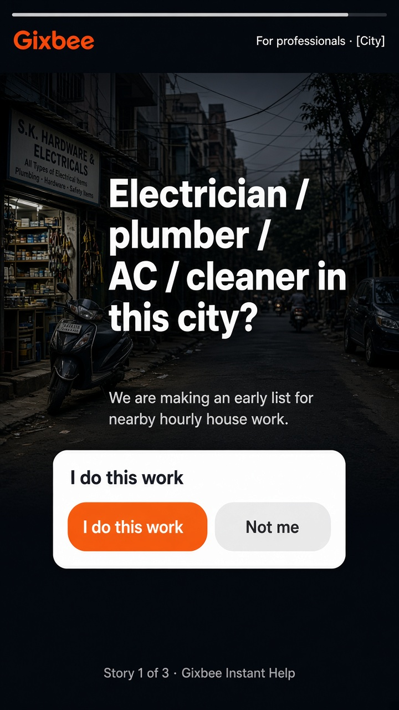
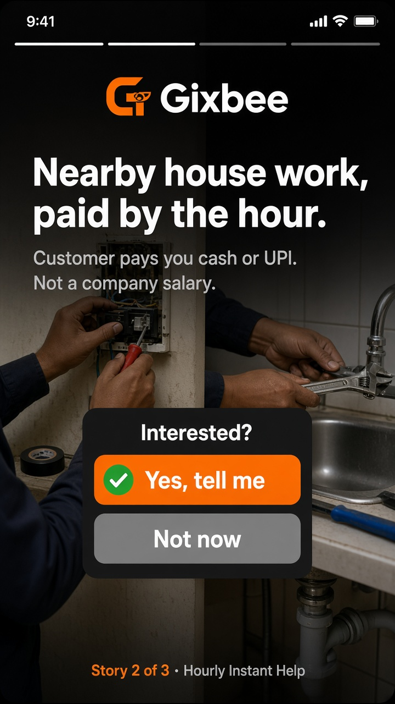
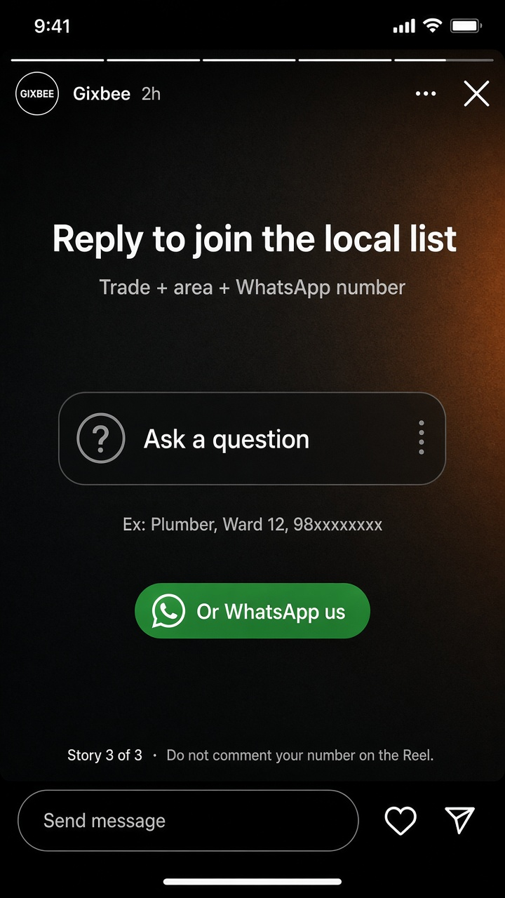
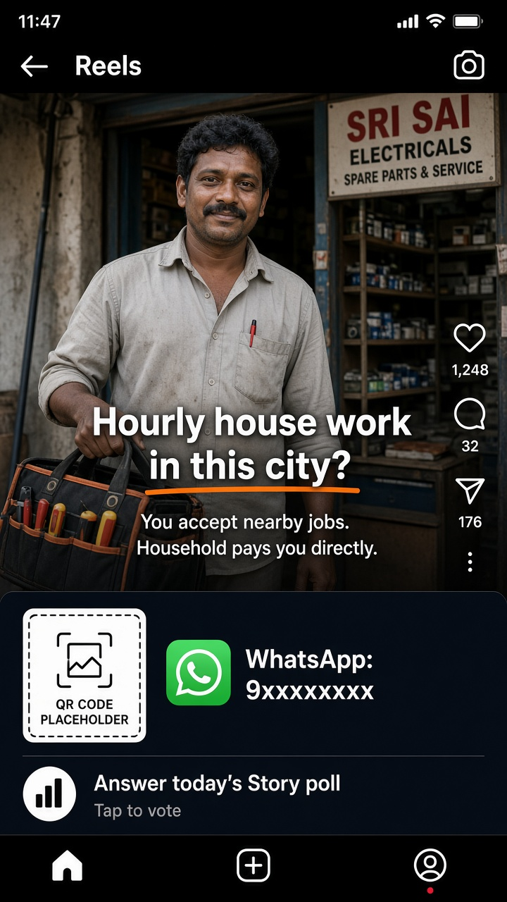

# Pre-launch worker community for Gixbee

Operating playbook • Instant Help first • One Indian city • Supply density over follower count

This document is the execution plan for collecting **verified, nearby professionals** before paid customer launch. It extends [GIXBEE_BUSINESS_FLOW.md](./GIXBEE_BUSINESS_FLOW.md) §3. It does not authorize paid ads, bulk SMS, or customer push campaigns.

## 1. What success actually is

Gixbee Instant Help only works if a request in a small map polygon finds a **verified, Go Live professional** who can accept, travel, and finish the job. A 20,000-member WhatsApp group across India, or a viral Instagram reel, does not create that. A marketplace with empty supply in the customer's neighborhood dies on the first request.

**Primary goal (pre-launch):** enough *usable* professionals in 2–3 adjacent neighborhoods and 3–4 household trades that a test request at staffed hours is usually accepted.

**Not the goal:** national brand community, follower count, or "maximum workers" as a raw number.

| Metric | Why it matters | Launch gate (internal, not a customer promise) |
| --- | --- | --- |
| Verified professionals per trade per neighborhood | Instant Help matching is local | Aim for **8–12 verified** people who actually work that trade in that area, not 8 names on a list |
| Share who completed identity + skill profile | Unverified names cannot Go Live | **≥70%** of waitlist in the launch polygon complete verification |
| Share who completed a supervised test job | Proof they can use the app | **≥5 people per launch trade** in the polygon |
| Typical travel time inside the polygon | Long travel kills earnings and response | Most accepts should be a short local trip, not city-wide |
| Languages recorded | Booking language matching | Every verified pro has spoken languages set |

A city-wide list of 500 electricians with no pin-level location is weaker than **30 electricians who live or already work in the two launch wards**.

## 2. Why "big community first" fails here

Independent household professionals in India already have work from neighbors, contractors, and existing WhatsApp contacts. They join a new app only if it looks like **more local jobs without losing control of cash**. They will not wait months for a national community to "activate."

| Approach | What it produces | Risk for Gixbee |
| --- | --- | --- |
| One huge city/state WhatsApp group | Noise, spam, people from the wrong area | Unusable for matching; group dies |
| Instagram-first worker recruitment | Views from students and other cities | High awareness, low verified local supply |
| Facebook groups / LinkedIn | Wrong occupational mix for Instant Help | Time spent on people who will never Go Live |
| National waitlist with no area filter | Impressive spreadsheet | Cannot open Instant Help anywhere |
| Field + neighborhood WhatsApp + referrals | Smaller list, high density | This is the working model |

Customer demand should stay **quiet** until the launch polygon can fulfill. Recruiting customers first creates failed searches and a reputation the product cannot recover from.

## 3. Channel ranking (use in this order)

WhatsApp is the home of this community. Instagram, YouTube Shorts, and printed material exist to **feed WhatsApp and field onboarding**, not to replace them.

| Rank | Channel | Role | Convert to |
| --- | --- | --- | --- |
| 1 | Street and trade-network field work | Highest trust. Meet the person, see tools, record area. | Waitlist row + neighborhood WhatsApp cell |
| 2 | Worker-to-worker referral | Same trade, same area, already trusted | Waitlist with referrer id |
| 3 | Neighborhood / trade WhatsApp cells | Daily contact, launch instructions, rumor control | Verified profile when the app opens |
| 4 | Existing trade associations, unions, tool shops, hardware stores | Clusters of the right people | Saturday onboarding desk |
| 5 | Short video (Instagram Reels, YouTube Shorts, WhatsApp Status) | Proof that Gixbee is real; not the CRM | Link-in-bio / QR to waitlist |
| 6 | Printed QR cards at hardware shops and tea stalls in the polygon | Reaches people who do not follow brands | Waitlist |
| 7 | Paid ads | Only after organic density is measurable | Same waitlist, with UTM / referral code |

Do not build Telegram, Discord, or a public Facebook "community" as the primary home. Those are extra rooms to moderate. One CRM (spreadsheet or simple form) plus WhatsApp is enough before launch.

## 4. Community architecture (WhatsApp)

Never put all professionals in one group. Split by **place** first, then **trade**. One person may sit in a neighborhood group and a trade group. Broadcast (WhatsApp Business) is for announcements. Groups are for questions and local coordination.

```
City ops (internal staff only)
  └── Launch city hub (staff + 8–12 worker captains)
        ├── Neighborhood A cell (all launch trades in that polygon)
        ├── Neighborhood B cell
        ├── Neighborhood C cell (only if A and B are dense)
        ├── Trade: Electrician (city-launch, optional)
        ├── Trade: Plumber
        ├── Trade: AC technician
        └── Trade: Household cleaning
```

### Rules that keep groups alive

- **Size:** keep cells under ~80 people. Above that, split by neighborhood. WhatsApp's hard cap is not the operating target.
- **Captains:** one paid or stipend city lead; one volunteer captain per cell (a respected local pro). Captains get early access, a named badge later, and the first test jobs. They do not get fake "manager" powers inside the product.
- **Content:** jobs, onboarding steps, verification status, honest "no customer jobs yet" messages. Ban rate talk that is not Gixbee policy, ban forwarding of unrelated work, ban customer phone-number dumping.
- **Language:** run the cell in the language those workers actually speak. Hindi/English-only groups in a Malayalam or Tamil launch city will empty out.
- **Broadcast vs group:** weekly status and launch date go out as a Business broadcast to people who opted in. Groups are not a newsletter.
- **No job spam before supply is live:** do not forward random "need electrician" customer messages into groups. That trains people to ignore Gixbee and work off-platform, and it skips verification, tracking, and dual payment confirm.

### What to collect on join (same fields as field onboarding)

A Google Form / WhatsApp flow is enough. Every row needs:

1. Full name as on ID  
2. Mobile (WhatsApp)  
3. Launch neighborhood (pick list, not free text)  
4. Primary trade (Electrician, Plumber, AC Technician, Cleaner; optionally Carpenter later)  
5. Sub-skills (from the Register as Pro list: switch/socket, leak, AC gas, bathroom clean, …)  
6. Tools they already own  
7. Languages they can work in  
8. Typical working hours  
9. Indicative hourly expectation (for ops, not a published rate card)  
10. How they heard (field / referral / reel / shop QR)  
11. Referrer mobile if any  
12. Consent: Gixbee will contact them for verification and test jobs; no guarantee of job volume  

This is the waitlist. It is **not** a user account. Accounts are created at onboarding with OTP, profile, and identity review.

### Create the WhatsApp groups (phone steps)

Do this on **WhatsApp Business** on one dedicated Gixbee SIM (city lead's work phone). Do not use a personal family WhatsApp. You need a second staff number saved in that phone's contacts before you can create a group.

**Day 0 — prepare the phone (30 minutes)**

1. Buy a local prepaid SIM. Name the contact line something ops can recognize, for example `Gixbee [City] Pros`.
2. Install **WhatsApp Business** (not the personal app) on that phone.
3. Register with the new SIM. Skip catalog and shopping. This is for groups and replies, not a store.
4. Profile:
   - Name: `Gixbee [City]`
   - Photo: Gixbee logo
   - About: `Nearby hourly house work. Early professional list for [neighborhoods]. Not a salary job. Household pays you cash/UPI.`
   - Business category: Professional services / Application
5. Settings → Business tools → **Away message** (optional): `Send: 1) trade 2) area 3) this number. We add local professionals only.`
6. Save these contacts before creating groups: city lead personal phone, second coordinator, and later each captain.

**Which groups to create (in this order, not all at once)**

| Order | Group | Who is in it | When to create |
| --- | --- | --- | --- |
| 1 | `Gixbee [City] Ops` | Staff only (2–4 people) | Day 0 |
| 2 | `Gixbee [Ward A] Pros` | Staff + professionals who work Ward A | When the first 3 waitlist rows for that ward exist |
| 3 | `Gixbee [Ward B] Pros` | Same for Ward B | Same rule |
| 4 | `Gixbee [City] Captains` | Staff + 1 captain per cell | After you have named captains |
| 5 | Trade groups (`Gixbee [City] Electricians`, …) | Optional. Only if a neighborhood cell is noisy | Later, not day 0 |

Do **not** create one `Gixbee All India` or `Gixbee [City] Everyone` group.

**Create one neighborhood group (repeat for Ward B)**

1. Open WhatsApp Business → **Chats**.
2. Tap the new-chat icon → **New group**.
3. Select only staff numbers first (city lead + coordinator). You can add workers later. Tap the check mark.
4. Group subject (name): `Gixbee [Ward A] Pros`  
   Example: `Gixbee Ramanattukara Pros`. Keep it under ~25 characters so phones show the full name.
5. Group photo: Gixbee logo, or a photo of that ward's landmark with the logo in the corner.
6. Create the group.
7. Tap the group name at the top → **Group settings**:
   - **Edit group settings:** Admins only (so random members cannot rename it).
   - **Send messages:** Everyone (they need to ask questions). If spam starts, switch to Admins only and move Q&A to DMs.
   - **Add members:** Admins only. People join by **invite link** or an admin adds them. Members must not add strangers.
   - **Disappearing messages:** Off. You need history.
   - **Lock:** leave unlocked for admins.
8. **Add group description** (paste, then fill brackets):

```
Gixbee early list for professionals who already work in [Ward A], [City].
Hourly nearby house work. Customer pays you cash or UPI. Not a company salary. No daily job promise.
Open trades: electrician, plumber, AC, household cleaning.
Rules: no sharing customer numbers, no other-app ads, no ID photos in this chat.
Admin: [city lead name] [Gixbee SIM number]
```

9. **Invite link:** Group info → Invite via link → Send link via…  
   Use this link only in **1:1 WhatsApp** and on the field QR form. Do not post the raw link on a public Instagram Reel or in comments. Reset the link if it leaks.
10. Make the coordinator and later the ward captain **Admins** (Group info → member → Make group admin). Staff keep at least two admins so one lost phone does not lock the group.

**First three messages to pin / send (copy)**

Send these as soon as the group exists, before adding workers. Star or pin the first one (long-press → Pin, if the WhatsApp version allows; otherwise repeat it weekly).

Message 1 — welcome:

```
Welcome to Gixbee [Ward A] professionals.
This group is only for people who work in [Ward A].
Gixbee is an app for nearby hourly house jobs. The household pays you directly (cash/UPI). Gixbee is not a contractor and does not hold your job money.
We are collecting the local list and will test a few jobs before public launch. No salary. No guarantee of daily work.
If this is the wrong area, tell admin and we will move you.
```

Message 2 — how to stay:

```
Please send one message with:
1) Name
2) Trade (electrician / plumber / AC / cleaner)
3) Area inside [Ward A]
4) Languages
We will add this to the waitlist. Documents and ID only through the app later, not here.
```

Message 3 — rules:

```
Rules: no forwarding random job leads, no customer phone numbers, no other apps, no fights about rates.
Questions: message [Gixbee SIM].
```

**How a new worker actually gets into the group**

1. They come from field QR, Instagram Story, or a referral.
2. Staff already has their **trade + area + WhatsApp** on the sheet.
3. If the area is Ward A: city lead opens `Gixbee [Ward A] Pros` → Add members → search that number (they must have WhatsApp, and it helps if they have messaged you first so they appear). Or send the **invite link** in a 1:1 chat: `This is the [Ward A] group only. Please join and send your name + trade.`
4. If they live in another city: do not add. Reply: `We are only opening [wards] first. We will keep your number for later.`
5. Update the sheet: neighborhood cell = Ward A.

**Daily admin (10 minutes)**

- Reply to 1:1 DMs on the Business number first (that is where Instagram "Yes" people land).
- Add yesterday's waitlist people to the correct ward group.
- Mute or remove anyone posting other-app ads or customer numbers.
- Once a week in the group: honest status, for example `Still filling [Ward A]. App test not public yet. N people on the local list.` Use a real number.

**What not to do**

- Do not create 10 empty groups "for later." Empty groups die.
- Do not add 200 people from an old contact list.
- Do not use the neighborhood group as a customer complaint line.
- Do not forward "need electrician today" household messages into the group before Instant Help is open.

## 5. Which trades to recruit first

Open Instant Help with household tasks that are frequent, local, and do not need specialist operating procedures Gixbee does not yet staff.

| Open at launch (recommended) | Delay until ops is ready |
| --- | --- |
| Electrician (switch, fan, light, MCB) | Nurse / bedside care (credential + safety) |
| Plumber (tap, blockage, leak) | Driver (licensing, insurance, different matching) |
| AC technician (service, gas, leak) if seasonal demand exists | Beautician, pest control, renovation (scope and materials disputes) |
| Household cleaner (bathroom, kitchen, home) | Electronics / appliance beyond AC unless a captain exists |

Carpenter can be a fifth trade **if** field recruiting already found a cluster in the same polygon. Do not add trades to look complete.

## 6. Field playbook (this is the main engine)

City lead plus 1–2 local coordinators walk the launch polygon. Target places where independent pros already gather.

**Where to stand**

- Electrical / plumbing / AC spare-part shops  
- Hardware stores and paint shops  
- Morning tea stalls near labor addas  
- Housing-society maintenance rooms (introduce the product to the supervisor, then to the regular electrician/plumber)  
- Trade association meetings if they exist in that city  

**What to say (honest, 30 seconds)**

Gixbee is an app for nearby household jobs. The customer pays you directly by cash or UPI. Gixbee is not a contractor and does not hold your job money. Before public launch we are taking only local professionals in *this* area, checking ID and skills, and running a few paid test jobs. If you join the waitlist you get the app first in this neighborhood. There is a small access credit pack later if you want to accept Instant Help jobs. No salary. No guarantee of daily jobs.

**What to do on the spot**

1. Scan QR → form, or fill it on the coordinator's phone.  
2. Add them to the **neighborhood cell**, not a giant city group.  
3. Photograph tools only with consent, for later capability review.  
4. Give a printed card: "Gixbee [City] professionals — WhatsApp [number]".  
5. Ask: "Who else in this ward does the same work?" Capture two referrals.

**Cadence:** 5 field days per week in the polygon until the density table in §1 is met. One Saturday "document camp" for ID photos and profile completion once the APK is ready for closed testing.

## 7. Instagram and short video (support channel, not the community)

Use video and Story questions to make the waitlist feel real. Do not try to recruit India. Geo and language should match the launch city.

**Who should appear:** actual local professionals (with consent), the city lead, short clips of a test booking flow. Avoid actor-heavy ads that look like a national brand the product cannot support.

A Reel that only gets likes is a failed post. The job of every video and every Story sticker is a **reply we can put on the waitlist**: trade + neighborhood + WhatsApp number.

### 7.1 Question stickers (this is the hourly-work funnel)

Instagram Stories reach people who will never comment on a Reel. Use **poll / quiz / question** stickers every day. The pitch is Instant Help: nearby household tasks, **hourly**, customer pays you directly.

Run this three-story sequence. Post it in the launch-city language. Repeat 4–5 days a week.

**Story 1 — filter (poll)**

- On-screen: photo of tools or a local street, not a stock office.
- Text: `Electrician / plumber / AC / cleaner in [city]?`
- Poll: `I do this work` | `Not me`

If they tap "Not me", next Story can be a household waitlist later. Do not mix them into worker onboarding.

**Story 2 — hourly interest (this is the one you asked for)**

- Text: `Nearby house work, paid by the hour. Customer pays you cash/UPI. Interested?`
- Poll: `Yes, tell me` | `Not now`
- Alternate wording (rotate so it does not look like spam):
  - `Hourly local jobs in [ward]. Want early access?`
  - `Fan repair, tap leak, AC service — hourly. Join the list?`
  - `Not a company salary. Your own work, nearby requests. Interested?`

**Story 3 — capture (question box)**

- Sticker type: **Questions** (open text).
- Prompt: `Reply: trade + area + WhatsApp number`
- Example helper text on the same frame: `Ex: Plumber, [Ward], 98xxxxxxxx`
- Also put the WhatsApp Business link in the Story link sticker.

**Story 4 (optional) — quiz that teaches the product**

- Quiz: `On Gixbee, who pays you for the job?`
- Options: `The house owner (cash/UPI)` (correct) | `Gixbee salary`
- Follow-up frame: `Correct. We do not hold your job money.`

DM everyone who taps **Yes, tell me** the same day with this copy (local language):

> Thanks. Gixbee is opening hourly nearby house work in [neighborhoods] first. Not a salary job. Household pays you directly. Reply with: 1) electrician / plumber / AC / cleaner 2) which area you work 3) this WhatsApp number. We will add you to the local list. No guarantee of daily jobs.

If they reply with those three fields, add a CRM row with source `ig-question` and invite them to the **neighborhood WhatsApp cell**, not a public comment thread.

Do not use "Are you interested in hourly work?" as a public Reel comment bait with no DM follow-up. Public comments will be from other cities and from people collecting free leads.

Visual layout reference (copy the structure, replace city/ward and shoot your own photos):

| Story 1 filter | Story 2 hourly poll | Story 3 capture | Reel hook |
| --- | --- | --- | --- |
|  |  |  |  |

### 7.2 Ready-to-shoot Reels (15–30 seconds)

Shoot vertical, noisy real locations, captions burned in (many people watch muted). End card: WhatsApp number + `Story: answer the hourly poll`. Post the same file to Reels, YouTube Shorts, and captains' WhatsApp Status.

**Reel A — the hourly question (worker-facing)**

| Time | On screen | Voice |
| --- | --- | --- |
| 0–3s | Face or tools. Text: `Hourly house work in [city]?` | "If you already fix homes near [landmark]…" |
| 3–12s | Three cuts: switch, tap, AC. | "Electrician, plumber, AC, cleaning. Customer calls nearby. You accept. They pay you by the hour, cash or UPI." |
| 12–20s | Text: `Not a company job` | "Gixbee is the app. We do not take your job money. We do not pay a salary." |
| 20–28s | QR + WhatsApp | "Interested? Answer the question in our Story today: trade, area, WhatsApp." |

**Reel B — tool-shop standup**

Film in a spare-part shop with the owner's consent. Hook: name the junction. CTA: Story poll.

**Reel C — myth**

Hook: `Does Gixbee keep my money?` Answer: no. Household pays you. CTA: hourly poll.

**Reel D — how a job works** (only after a test booking exists)

Screen recording: request → accept → arrival OTP → bill. No fake 5-minute promise. CTA: "Captains in [ward] already tested this. Story poll if you want in."

**Reel E — captain Q&A**

Hook: `Is this a company job?` Answer: no. `When do jobs start?` Answer: after we fill this area and test the app. Honest dates only.

Caption template for every Reel:

> Hourly nearby house work in [city]. Electricians, plumbers, AC, cleaners. Customer pays you directly. Not a salary. Early list only for [wards]. Answer the Story question: Yes + trade + area.

Hashtags: local area tags plus trade tags (`#ThrissurElectrician` style). Skip generic `#earnfromhome` / `#workfromhome`. Wrong audience.

### 7.3 Weekly posting rhythm (one phone, one person)

| Day | Feed / Reels | Stories (must do) |
| --- | --- | --- |
| Mon | Reel A or E (hourly question) | Poll sequence §7.1 |
| Tue | — | Poll sequence + reply to yesterday's DMs |
| Wed | Reel B (shop) or photo of QR card on a counter | Poll sequence |
| Thu | — | Quiz: who pays you? Then question box |
| Fri | Reel C (myth) | Poll sequence |
| Sat | Field selfie / document-camp clip | "We are at [shop] until 1pm. Same Story question." |
| Sun | — | Recap: "This week N people in [ward] joined the list" (real number only) |

Batch-shoot Saturday: 4 talking-head clips + 1 shop clip is a full week.

### 7.4 What never to put in a video or sticker

- Guaranteed daily income, "₹500/hour for everyone," Urban Company-style arrival SLAs, platform insurance, escrow, or "we pay your salary."
- "Jobs available now" before test bookings exist. Say **early list / hourly work when we open this area**.
- Asking people to comment their phone number on the Reel. Phones go to DMs or WhatsApp only.

**Profile hygiene:** one Instagram account named Gixbee, city in bio, WhatsApp link, waitlist link, highlight "For professionals" vs "For households." Household content stays off until supply gates pass. Record Story question replies into the CRM the same day; Instagram expires them in 24 hours.

## 8. Referral mechanic (workers bring workers)

Before the app, run this on WhatsApp. After the app, the same codes can become in-app later.

- Each waitlist person gets a short code: `GX-EL-WARD-042`.  
- If they bring **two verified professionals in the same launch polygon and trade**, they get first-wave test jobs and a captain nomination.  
- After paid launch, convert that to a **one-time credit pack or fee holiday**, not cash that looks like a pyramid. Keep it attributable.  
- Reject referrals from other cities. Thank them and say Gixbee is not open there.

## 9. 10-week sequence (do not skip weeks)

Weeks assume the APK and verification ops can actually onboard. If product gates in [GIXBEE_BUSINESS_FLOW.md](./GIXBEE_BUSINESS_FLOW.md) §10 are still red, keep collecting the waitlist but do not promise a date.

| Week | Supply work | Demand / content | Exit check |
| --- | --- | --- | --- |
| 1 | Freeze launch city, 2–3 neighborhoods, 3–4 trades. Print QR. Open form. | Zero customer ads. | Map polygons and pick-list neighborhoods exist |
| 2–3 | Field every day. Seed 3 neighborhood WhatsApp cells. Appoint captains. | Daily Story poll "hourly work — interested?" plus 3 local-language Reels; DM every Yes the same day | ≥40 waitlist rows with neighborhood + trade filled |
| 4 | Saturday document camp. Start identity/capability review for the densest trade | Reels using real waitlist faces (consent) | First trade has 8+ complete profiles in one polygon |
| 5 | Repeat camp for remaining launch trades. Drop people outside the polygon from cells (move to "later city" broadcast) | Shop posters in the polygon only | Density table started for each trade |
| 6 | Closed APK: captains + 10 volunteers complete Register as Pro, languages, radius | No public Play Store push | Captains can Go Live in staging/prod as designed |
| 7 | Supervised test bookings with consenting households (staff, friends, society offices). Pay the professional the real bill. | Film *real* test jobs only | OTP, GPS, bill, dual pay confirm work |
| 8 | Fill coverage holes from declined/missed test offers. Do not add new neighborhoods. | Prepare household waitlist (separate, small) | Unmet test demand has a recruiting response |
| 9 | Staffed hours defined. Only open trades/areas that passed tests. | Household WhatsApp for the same polygon only | Fulfillment rate on tests is acceptable to city lead |
| 10 | Paid Instant Help on for those hours/areas. Keep worker cells. Start customer referrals after completed jobs. | Light local household content | Daily ops review: missed demand, earnings, disputes |

If week 6 fails (app/verification), do not run week 9 customer open. Keep the worker cells warm with honest status, not invented job pings.

## 10. How to talk about money (so the community does not revolt)

Professionals will ask three questions. Answer the same way in every group and reel.

1. **Who pays me?** The household, cash or UPI, to you. Gixbee does not hold that money.  
2. **What do I pay Gixbee?** Access to Instant Help (job credits and a period fee after a configured number of jobs). Explain both together at onboarding. Do not hide them in a viral video and surprise people at Go Live.  
3. **How much will I earn?** Unknown. Share only what test jobs in *this* polygon actually paid, after travel. Never publish a "₹X per day" promise.

Travel on Instant Help is a one-way petrol component at the configured per-km rate. Say that clearly. Materials are extra and need customer agreement in chat.

## 11. Community moderation and trust

- One staff member reads every cell daily.  
- Pin: launch area, "no job volume promise," support number, verification steps.  
- Remove recruiters selling other apps, people asking for customer numbers, and anyone sharing ID documents in-group (IDs go only through the app/admin path).  
- Safety: Gixbee is not an emergency service. Do not imply 24×7 coverage until hours are staffed.  
- Women professionals (cleaning, and later other trades): offer a smaller women-only cell if they ask; do not force mixed groups.

## 12. Lightweight CRM (before building product)

A single sheet (or Airtable) with columns matching §4, plus: verification status, APK installed, test job done, neighborhood cell, captain, drop reason. Tag every row with a source code (`field`, `referral`, `reel`, `ig-question`, `shop-qr`). Review twice a week: **usable density**, not total rows. Treat Instagram poll taps as interest only; a row counts when trade + area + WhatsApp are on the sheet.

When the app launches, this sheet is the call list for "install, verify, Go Live." It is not a substitute for `worker_profiles` in production.

## 13. What to stop doing

- Creating 20 Instagram accounts or city pages you cannot post to.  
- Mixing job-seekers (Find a Job / Smart Hiring) into Instant Help worker cells. Different product, different promise.  
- Buying group members or running "forward this to 10 groups" contests.  
- Opening customer ads while waitlist people still live across the whole city.  
- Promising that a WhatsApp community *is* Gixbee. The community is a waiting room. The product is verified Go Live + completed jobs.

## 14. Best idea, compressed

**Treat pre-launch as a density campaign in two or three neighborhoods, not a national community launch.**

1. Pick the polygon and 3–4 trades.  
2. Put a city lead on the street with a QR waitlist.  
3. Hold professionals in small neighborhood WhatsApp cells with local captains.  
4. Use Instagram/Reels only as a local proof engine that points at WhatsApp.  
5. Verify, test-book, then open Instant Help only where those tests worked.  
6. Let completed jobs and worker referrals grow the next street. Keep customer marketing one step behind supply.

That sequence matches how Instant Help matching actually works in the product. A large undifferentiated community does not.
