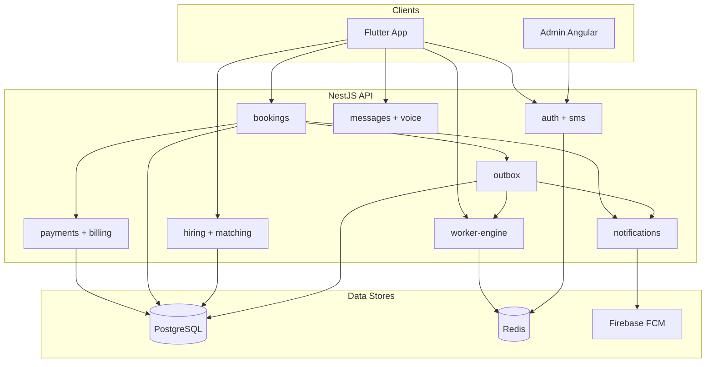

# Gixbee — System Architecture

> **Owner:** Jim (architecture) · **Status source of truth:** [../CURRENT_STATUS.md](../CURRENT_STATUS.md)  
> Last updated: **2026-08-30**

---

## 1. Executive summary

Gixbee is an **intent-based** multi-service platform: one user can book services, work gigs, find jobs, and list businesses in the same session. The system is split into three deployable surfaces:

| Surface | Stack | Role |
|---|---|---|
| **Mobile app** | Flutter + Riverpod | Customer, worker, talent, and business-owner UX |
| **API** | NestJS 11 or Rust (Axum) — see [ADR-009](./adr/009-rust-backend-drop-in.md) | REST, WebSocket, background jobs, payments, notifications |
| **Admin portal** | Angular 19 | Staff operations, ACL-gated pages, infra monitoring |

Shared infrastructure: **PostgreSQL** (via **PgBouncer**), **Redis** (OTP, cache, Bull queues, Socket.IO adapter), **Firebase FCM**, **Razorpay**, **MSG91 SMS**.

Production runs on the **MilesWeb VPS** (`103.102.234.152`) behind Docker Compose with **2 backend replicas**, Nginx load balancing, Beszel/Dozzle/pgAdmin for ops.

### Backend implementation switch

Set `BACKEND_IMPL=nest|rust` in `.env` (see [ADR-009](./adr/009-rust-backend-drop-in.md)). Both implementations register Docker network alias `api`; Nginx and admin proxy `http://api:3000`. Flutter and admin URLs stay on port **3000**.

```bash
BACKEND_IMPL=rust make dev    # Rust (Axum) — default in .env.example
BACKEND_IMPL=nest make dev    # NestJS rollback
```

---

## 2. High-level topology

```
┌─────────────────────────────────────────────────────────────────────────┐
│                           Clients                                        │
│  Flutter app (Android/iOS)          Angular admin (super-admin-web/)    │
└───────────────┬───────────────────────────────┬─────────────────────────┘
                │ REST + JWT                    │ REST + JWT (admin role)
                │ Socket.IO (JWT in auth)       │
                ▼                               ▼
┌───────────────────────────────────────────────────────────────────────────┐
│  Nginx LB  →  NestJS backend ×2  (main.ts: RedisIoAdapter, throttler)    │
│    ├── REST controllers (27 modules)                                      │
│    ├── WebSocket gateways: worker, messages, voice-calls                  │
│    ├── Bull processors: bookings, outbox                                  │
│    └── Static: /uploads                                                   │
└───────┬───────────────────────┬───────────────────────┬───────────────────┘
        │                       │                       │
        ▼                       ▼                       ▼
   PgBouncer              Redis                   Firebase Admin
   (transaction pool)      OTP · Bull · IO         FCM push
        │                   adapter · locks
        ▼
   PostgreSQL 16
   (TypeORM entities, migrations in prod)
```

**Design principle:** Gixbee facilitates; it never assigns. Bookings, acceptances, and hiring decisions are user-driven.

---

## 3. Backend architecture (NestJS)

### 3.1 Module map

Root wiring lives in `backend/src/app.module.ts`. Each feature is a NestJS module (controller + service + entity + module file).

| Module | REST prefix | Primary responsibility |
|---|---|---|
| `auth` | `/auth` | OTP (Redis + MSG91), JWT access/refresh, admin login, FCM token |
| `sms` | — | MSG91 v5 Flow (used by AuthService) |
| `users` | `/admin-user-list` | Admin user list (paginated) |
| `workers` | `/workers` | Worker profiles, verification, strikes, availability |
| `worker-engine` | WS | Go Live presence, GPS fan-out, job rooms |
| `bookings` | `/bookings` | Full booking lifecycle (Instant, Plan, targeted) |
| `billing` | `/billing/credits` | Job credits, period fee packs |
| `wallets` | `/wallets` | Dormant while `WALLET_PAYMENTS_ENABLED=false` |
| `payments` | `/payments` | Razorpay orders, webhook (raw body HMAC) |
| `rentals` | `/rentals` | Rental catalog, reservations, calendar |
| `hiring` | `/hiring` | Classic job board + applications |
| `hiring/matching` | `/hiring/match` | Smart Hiring (Job Types, Offers, match fee) |
| `businesses` | `/businesses` | Service / Hiring / Rental business units |
| `talent` | `/talent` | Talent profiles, Aadhaar eKYC (Surepass) |
| `messages` | `/messages` + WS | Thread list + real-time chat |
| `voice-calls` | `/bookings` + WS | WebRTC signaling for in-app calls |
| `notifications` | `/notifications` | FCM send + in-app notification list |
| `favourites` | `/favourites` | Saved workers |
| `addresses` | `/addresses` | Saved addresses |
| `cities` | `/cities` | City catalog |
| `support` | `/support` | Support tickets |
| `master-entries` | `/master-entries` | Configurable rates/fees (cached, capped) |
| `admin-staff` | `/admin-staff` | Staff accounts + page ACL |
| `system-logs` | `/system-logs`, `/client-logs` | Server + Flutter crash logs |
| `system-metrics` | `/system-metrics` | Health/metrics for admin dashboard |
| `redis` | `/redis/admin` | Admin SCAN-based key browser |
| `outbox` | Bull `outbox` queue | Transactional outbox → FCM + socket side effects |

**Uploads:** `UploadController` + `ServeStaticModule` at `/uploads`.

### 3.2 Bookings domain decomposition

`BookingsModule` splits concerns across focused services (not a god-class):

| Service | Concern |
|---|---|
| `BookingsService` | Orchestration, CRUD, status transitions |
| `BookingBroadcastService` | Instant Help fan-out (waves, Redis pending set) |
| `BookingClaimService` | Worker accept + credit debit |
| `BookingCancelService` | Stage-gated cancel, late-cancel strikes |
| `BookingProgressService` | GPS progress checks (Bull) |
| `BookingSettlementService` | Dual-confirm pay, petrol billing |
| `BookingStatusService` | Redis-backed status snapshot for HTTP fallback |
| `BookingDispatchService` | Targeted / scheduled dispatch |
| `BookingsProcessor` | Bull jobs: timeouts, progress GPS, reminders |

Lifecycle side effects are written to **`outbox_events`** and dispatched asynchronously (see §5).

### 3.3 Cross-cutting backend concerns

| Concern | Implementation |
|---|---|
| Auth | JWT (`AuthGuard('jwt')`), admin JWT with `pages[]` ACL |
| WS auth | `WsJwtGuard` — identity from verified token, never body fields |
| Validation | Global `ValidationPipe` (whitelist + transform) |
| Serialization | `ClassSerializerInterceptor` strips `@Exclude()` fields (PII, FCM, wallet) |
| Errors | `AllExceptionsFilter` — consistent envelope, no stack leaks on 5xx |
| Rate limit | Global 120 req/min; auth routes tighter (5 OTP/min, 10 verify/min) |
| Money model | `common/money-model.ts` — single source of truth |
| Production boot | `assertProductionSecrets()` in `main.ts` — refuses weak JWT, placeholder creds |
| DB | `synchronize: !isProduction`; migrations auto-run in prod |
| Replicas | Redis Socket.IO adapter required when `REDIS_ALLOW_MEMORY_FALLBACK=false` |

---

## 4. Flutter architecture

### 4.1 Layering

```
features/          Presentation (screens, Riverpod providers)
  └── 16 domain folders — see CURRENT_STATUS.md product table
repositories/      Data layer — Dio → REST (never call Dio from screens)
services/          Cross-cutting: socket, FCM, JWT, location, voice, maps
shared/            Models + gx_* design-system widgets
core/              AppConfig, theme, navigator, plugin registry
theme.dart         GxColors + context.gx tokens (Dark / Grab Green)
main.dart          Boot: Firebase, crash reporter, theme restore
main_wrapper.dart  Post-auth shell: tabs, FCM routing, socket lifecycle
```

**Conventions (from `.README.md`):**
- All state via **Riverpod** — no `setState` in business logic
- All API calls through **repositories** in `lib/repositories/`
- Theme via **`context.gx.*`** for shell accents; semantic colors stay fixed where intentional

### 4.2 Feature → repository mapping

| Feature folder | Primary repositories |
|---|---|
| `auth`, `onboarding` | `auth_repository` |
| `home`, `booking`, `map` | `booking_repository`, `worker_repository`, `booking_status_provider` |
| `worker` | `worker_repository`, `job_credits_repository` |
| `billing` | `job_credits_repository`, `payments_repository` |
| `jobs` | `hiring_repository`, `matching_repository`, `talent_repository` |
| `business` | `business_repository`, `matching_repository` |
| `rentals` | `rentals_repository` |
| `messages` | `chat_repository` |
| `profile` | `profile_repository`, `wallet_repository`, `addresses_repository`, `favourites_repository` |
| `notifications` | (FCM via `notification_service`; list via API) |
| `search`, `reels`, `graph` | `worker_repository`, `talent_repository` |

### 4.3 Realtime client stack

| Channel | Client | Use |
|---|---|---|
| Socket.IO | `socket_service.dart` | Job rooms, GPS, chat, voice signaling, booking events |
| FCM | `notification_service.dart` | Push when app backgrounded; typed `data.type` routing in `main_wrapper.dart` |
| HTTP fallback | `booking_status_provider.dart` | 5s poll when socket not live; backs off when `isLiveForPolling` |

Socket connects with JWT in `auth.token`. Personal room `user_<id>` for chat; job rooms re-joined on reconnect.

### 4.4 Build-time configuration

`lib/core/config/app_config.dart`:

| Dart define | Purpose |
|---|---|
| `API_BASE_URL` | REST base (required non-loopback in release) |
| `SOCKET_URL` | Socket.IO host (required non-loopback in release) |
| `OLA_MAPS_API_KEY` | MapLibre tiles + directions |
| `RAZORPAY_KEY` | Client-side checkout key |

Release builds **fail closed** on loopback URLs (`assertReleaseNetworkConfig`).

---

## 5. Data flows

### 5.1 Instant Help (live worker)

```
Customer: instant_request_screen
    → POST /bookings (INSTANT, skill, lat/lng, amount)
    → BookingBroadcastService fans out to nearby Go Live workers
    → outbox: booking.broadcast_created
        → FCM new_booking + Redis pending set
        → Worker: incoming_job_screen (90s accept window)

Worker accepts
    → PATCH /bookings/:id/accept (job credit debited)
    → outbox: booking.accepted
        → Socket + FCM to customer
        → Customer: waiting_for_worker → live_tracking_map_screen

Worker GPS (assigned pro only)
    → WS updateLocation → job room → customer map

Arrival → arrival OTP → ACTIVE → completion OTP
    → Dual-confirm markPaid (CASH/UPI outside app)
    → Petrol frozen at accept (acceptDistanceKm × instant_petrol_per_km)
```

**Cancel gates:** free while `REQUESTED` or 3 min post-accept; then worker-approved cancel or late-cancel strike; no unilateral cancel after `ARRIVED`/`ACTIVE`. `WORKER_NO_PROGRESS` allows free cancel when GPS shows no progress.

### 5.2 Plan Services / Rentals

```
Customer selects event location → browse vendors/rentals
    → POST /bookings or /rental-bookings
    → Vendor approve/reject (status PATCH)
    → Calendar block on acceptance
    → Direct coordination (messages, phone via masked counterpartPhone)
```

Non-Instant bookings skip broadcast fan-out; settlement remains dual-confirm cash/UPI.

### 5.3 Smart Hiring loop

```
Find a Job (candidate)                    Hire Employee (employer)
    │                                          │
    ├─ Job Types → POST /hiring/match/preferences
    ├─ Offers ← FCM hiring_offer              ├─ POST /hiring/match/requests (₹49–399 fee)
    └─ Applications tracker                   └─ Shortlist → Hired / Rejected
         │                                          │
         └──────────── matching.service ─────────────┘
              Razorpay HIRING_MATCH_FEE / EXTRA_JOB_TYPE_FEE
              Guarantee → users.hiringCreditBalance (not wallet)
```

Classic job board (`/hiring/jobs`, applications) remains secondary path.

### 5.4 Go Live / job credits

```
Worker: go_live_screen
    → Verification + location gates
    → POST go-live (worker-engine)
    → Periodic fee via Razorpay PERIOD_FEE → job credit batch
    → Each accept debits job_credit_per_accept (Master Entry, default 15)
```

Wallet recharge path is **disabled** (`WALLET_PAYMENTS_ENABLED=false`).

### 5.5 Transactional outbox

Pattern: write domain state + `outbox_events` row in same DB transaction; dispatch async.

```
Service mutation (commit)
    → OutboxService.enqueue(type, payload)
    → Bull job outbox:dispatch
    → BookingLifecycleHandler
        → FCM notifications
        → Socket emits to user_/job_ rooms
        → Redis pending cleanup
    → Safety net: repeatable poll every 5s (single scheduler via stable jobId)
```

Event types: `booking.broadcast_created`, `booking.accepted`, `booking.cancelled`, `booking.completed`, `booking.payment_confirmed` (`outbox/outbox.types.ts`).

---

## 6. Admin portal (Angular)

| Route | Page ACL key | Function |
|---|---|---|
| `/` | `dashboard` | Overview |
| `/bookings` | `bookings` | Booking oversight |
| `/verifications` | `verifications` | Worker KYC queue |
| `/disputes`, `/strikes` | `disputes` | Conduct review |
| `/support` | `support` | Tickets (paginated) |
| `/master-entries` | `master-entries` | Rate/fee config |
| `/cities` | `cities` | City management |
| `/users` | `users` | User list (paginated) |
| `/businesses` | `businesses` | Business units |
| `/staff` | `staff` | Admin staff + ACL |
| `/logs` | `logs` | System logs |
| `/monitoring` | `monitoring` | Beszel + Dozzle + pgAdmin embed |

Auth: `POST /auth/admin-login` → JWT with `role: ADMIN` and `pages[]`. Guards: `authGuard` + `pageGuard`.

---

## 7. Infrastructure (Docker Compose)

| Service | Purpose |
|---|---|
| `postgres` | Primary DB (`gixbee_db`), `statement_timeout=60s` |
| `pgbouncer` | Transaction pooling — **no** session features (LISTEN/NOTIFY, advisory locks) |
| `redis` | OTP, Bull, Socket.IO adapter, distributed locks |
| `backend` ×2 | API replicas behind Nginx |
| `nginx` | Load balancer + static admin |
| `beszel`, `dozzle`, `pgadmin` | Monitoring (admin `/monitoring`) |

**Replica safety:** outbox poller uses stable Bull `jobId`; log retention sweep uses `RedisService.acquireLock()`.

---

## 8. Security boundaries

| Area | Control |
|---|---|
| OTP | Redis TTL + atomic GETDEL; MSG91 in prod; `ALLOW_OTP_ECHO` blocked at boot |
| JWT | ≥32 char secret in prod; admin creds not default |
| API responses | PII / FCM / wallet stripped via `@Exclude()` |
| WS rooms | Personal rooms from JWT; job rooms require booking participation; GPS publish = assigned pro only |
| Uploads | Extension whitelist; SVG excluded |
| Payments | Razorpay webhook raw-body HMAC; placeholder keys rejected |
| Admin | Page ACL on every route; throttled login |
| Redis admin | SCAN capped at 1000 keys (no blocking `KEYS`) |

See also [../SECURITY_2026-07-13.md](../SECURITY_2026-07-13.md).

---

## 9. Money model (summary)

Source: `backend/src/common/money-model.ts`. Full ADR: [adr/001-wallet-off-razorpay-direct.md](./adr/001-wallet-off-razorpay-direct.md).

| Path | Settlement |
|---|---|
| Job completion | Customer pays pro directly; dual-confirm in app |
| Go Live credits | Razorpay `PERIOD_FEE` |
| Late-cancel unblock | Razorpay `LATE_CANCEL_COMPENSATION` |
| Smart Hiring | Razorpay `HIRING_MATCH_FEE` / `EXTRA_JOB_TYPE_FEE`; credit balance for guarantees |

**Default booking payment method:** `CASH` (not wallet).

---

## 10. Entity relationship (core)

```
User ──┬── WorkerProfile (1:1, optional)
       ├── TalentProfile (1:1, optional)
       ├── Booking (customerId / operatorId)
       ├── Business (owner)
       ├── JobCredit / CreditTransaction
       ├── PaymentOrder
       ├── Message, Favourite, Address
       └── WalletTransaction (dormant)

Business ──┬── JobPost ── JobApplication
           ├── RentalItem ── RentalReservation
           └── HiringRequest ── HiringInterest (Smart Hiring)

Booking ── WorkerStrike, OutboxEvent (by reference)
MasterEntry ── platform config (rates, fees)
AdminStaff ── page ACL
```

---

## 11. API contract review checklist

Before Oscar (backend) or Ryan (cross-cutting) ship changes, verify:

- [ ] DTO whitelist still matches Flutter repository payloads
- [ ] New fields don't leak via `@Exclude()` gaps on User/Booking
- [ ] Money paths respect `money-model.ts` (no new wallet charges)
- [ ] WS events documented if room names or event names change
- [ ] FCM `data.type` values synced with `main_wrapper.dart` handlers
- [ ] Migrations included for prod (`migrationsRun: true`)
- [ ] PgBouncer-safe queries only (no session-scoped Postgres features)
- [ ] Bull jobIds stable across deploys (outbox/timeouts)
- [ ] Admin ACL page key added if new admin route
- [ ] Master Entries updated if new configurable fee

Pam (Flutter API usage): coordinate when response shapes or error codes change.

---

## 12. Known risks & open items

From [../CURRENT_STATUS.md](../CURRENT_STATUS.md) (2026-08-28):

| Priority | Item | Architecture impact |
|---|---|---|
| P0 | MSG91 keys on EC2 | Auth path blocked in prod until configured |
| P0 | Razorpay live keys | Period fee, late-cancel, hiring fees, APK rebuild |
| P0 | Surepass Aadhaar keys | Pro verification gate |
| P0 | Secret rotation | JWT/admin/DB defaults on EC2 |
| P1 | EBS volume size | Build/deploy reliability |
| P1 | Stale backend specs | Tests don't match current guards/DTOs — not prod behaviour |

**Scalability notes:**
- 2 replicas OK for current load; Socket.IO + Redis adapter is the scaling path
- PgBouncer multiplexes 50 app connections × 2 replicas onto 40 server connections
- FCM fan-out is parallelized (July audit fix); watch booking broadcast wave counts under growth
- Master entries cache capped at 2000 on miss — safe for current catalog size

---

## 13. Related documents

| Document | Role |
|---|---|
| [../CURRENT_STATUS.md](../CURRENT_STATUS.md) | Done vs open truth |
| [../PROD_DEPLOY_CHECKLIST.md](../PROD_DEPLOY_CHECKLIST.md) | EC2 secrets + migration |
| [../../.README.md](../../.README.md) | Product overview + setup |
| [adr/](./adr/) | Architecture decision records |
| [GAPS.md](./GAPS.md) | Gap list vs CURRENT_STATUS + risk register |
| [PROTOTYPE_v147_HIRING_FLOWS.md](./PROTOTYPE_v147_HIRING_FLOWS.md) | v147 prototype vs shipped hiring UX/API |
| [../AUDIT_2026-07-13.md](../AUDIT_2026-07-13.md) | Perf/race audit |
| [../SECURITY_2026-07-13.md](../SECURITY_2026-07-13.md) | Security audit |

---

## 14. Diagram — module dependency (simplified)


