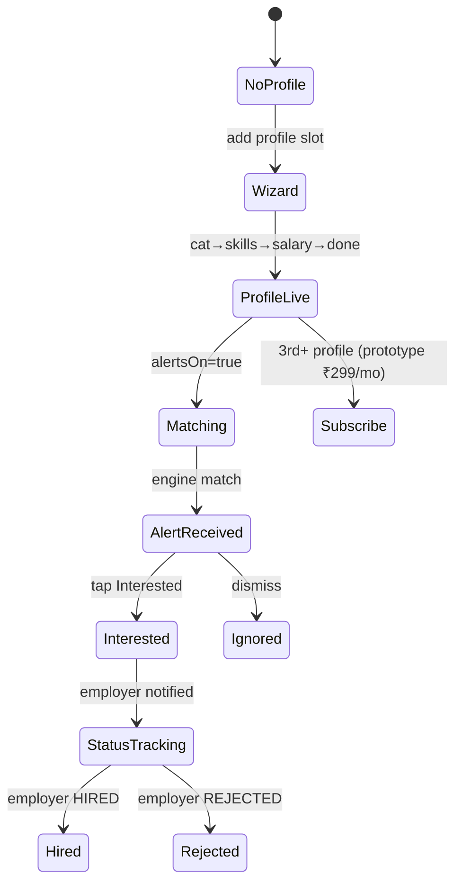
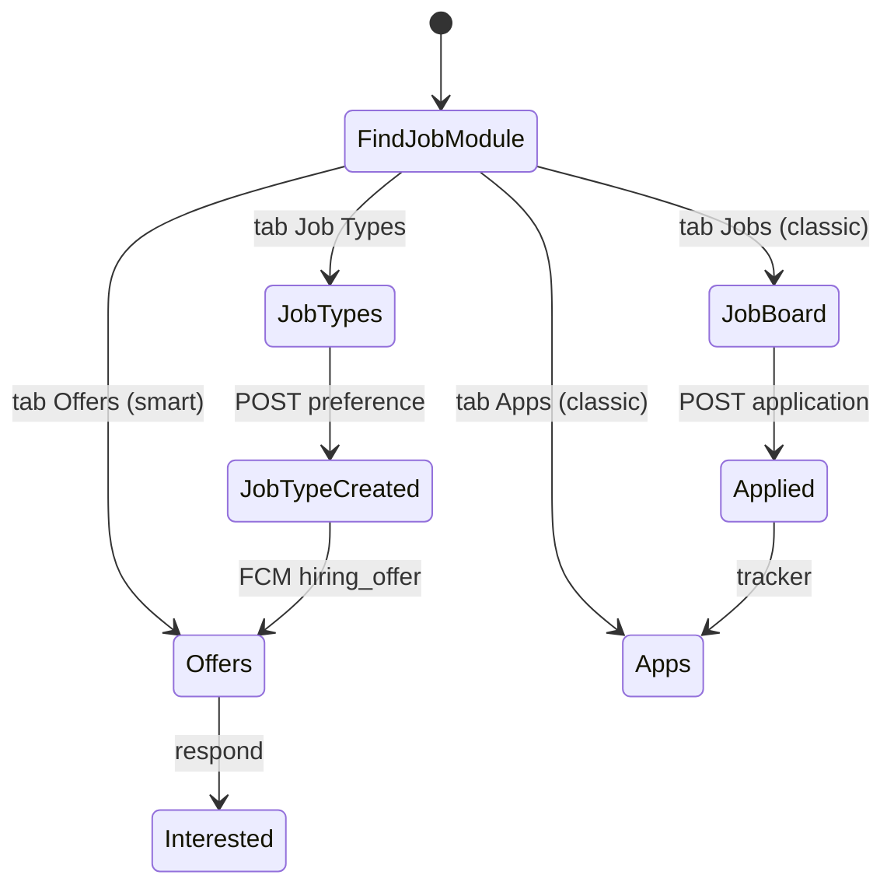

# Prototype v147 — Hiring Flow Architecture Study

> **Source:** `Gixbee_v147 (3).html` · extracted modules in `hive/research/prototypes/`  
> **Study date:** 2026-08-30 (Jim) · **Shipped truth:** [../CURRENT_STATUS.md](../CURRENT_STATUS.md)

---

## 1. Executive summary

v147 describes two related product surfaces:

| Module | Prototype emphasis | Shipped app emphasis |
|---|---|---|
| **Find a Job** | Multi **career profiles** home → **Alerts** → Interested → Status | Tabs: **Jobs · Offers · Job Types · Apps** |
| **Gixbee for Business** | Service / Rental / **Shop** / Hiring registration + rich unit dashboards | **SERVICE · HIRING · RENTAL** only; Smart Hiring via **Hire Employee** |

**Backend alignment is strong** for Smart Hiring (Job Types, Offers, match fee, salary rule, Interested gate). **UX alignment is partial** — shipped uses a tab shell and simplified employer form; prototype uses profiles-first navigation, richer category wizards, and a 4-step `hj1–hj4` post flow.

**Direction call (see [ADR-008](./adr/008-v147-profiles-alerts-ux.md)):** Treat v147 as the **target seeker/employer UX** layered on the **existing Smart Hiring API** (`JobPreference`, `HiringRequest`, `HiringInterest`). Do not fork a second matching engine. Migrate navigation and screens incrementally; classic job board remains secondary.

---

## 2. Prototype screen inventory

### 2.1 Find a Job (`gixbee_v147_job.html`)

`SCREENS`: `home`, `cat`, `skills`, `salary`, `done`, `alerts`, `alert-detail`, `interested`, `status`, `status-detail`, `edit`, `subscribe`, `no-alerts`

| Screen id | Purpose | Prototype nav tab |
|---|---|---|
| `home` | Career profile slots (2 free + subscribe); strength score; per-profile alert toggle | **Profiles** |
| `cat` | Job type: FT/PT/Intern/Contract + industry category catalog | (wizard) |
| `skills` | Skills checklist + doc upload per category | (wizard) |
| `salary` | Expected salary, locations, negotiable toggle, work mode | (wizard) |
| `done` | Profile live; explains alert → interested flow | (wizard) |
| `alerts` | Smart-matched job cards with salary match badge | **Alerts** |
| `alert-detail` | Match reasons; privacy note; "I'm Interested" | — |
| `interested` | Confirmation after sharing profile | — |
| `status` | Pipeline list (Interested / Shortlisted / etc.) | **Status** |
| `status-detail` | Timeline + employer updates | — |
| `edit` | Edit skills/salary/location (not job type) | **Settings** |
| `subscribe` | Unlimited profiles (₹299/mo prototype pricing) | — |
| `no-alerts` | Empty state when alerts off / no matches | — |

**Bottom nav (prototype):** Profiles · Alerts · Status · Settings  
**Data model (prototype JS):** `profiles[]` with `{ id, job, category, skills, salary, location, alertsOn, strength, alertCount, interestedCount }`; `FREE_LIMIT = 2`.

### 2.2 Gixbee for Business (`gixbee_v147_lmb.html`)

| Prefix | Screens | Purpose |
|---|---|---|
| `l1` | Entry | Pick Service / Rental / **Shop** / Hiring |
| `l2–l6` | Service reg | Category → card → docs → plan → verify |
| `l7–l18` | Service ops | Master dashboard, unit dashboard, calendar, requests, daily price |
| `r1–r7`, `r6a`, `r6c` | Rental | Catalog, add/edit units, pricing |
| `s1–s9` | **Shop** | Registration, dashboard, flash offers, claim mode |
| `h1–h6` | Hiring biz reg | Docs, plan, verify, hiring dashboard |
| `hj1–hj5`, `hjmatch` | **Hire Employee** | 4-step post + success + ranked candidate UI |

**Hire Employee wizard (prototype):**

| Step | Screen | Content |
|---|---|---|
| 1 | `hj1` | Sector / employment type + category catalog (mirrors seeker `cat`) |
| 2 | `hj2` | Title, skills, experience, education, work mode, languages, description |
| 3 | `hj3` | Location tabs, **salary range**, live **candidate count**, positions, negotiable, urgency, benefits |
| 4 | `hj4` | Preview (candidate-facing card) |
| — | `hj5` / `hjmatch` | Post success + **mc-*** ranked match cards (shortlist / view profile) |

---

## 3. Shipped Flutter route map

### 3.1 Find a Job (`lib/features/jobs/`)

| Shipped screen | File | Prototype analogue |
|---|---|---|
| Module shell (4 tabs) | `find_job_module.dart` | Bottom nav **Profiles/Alerts/Status/Settings** → **replaced by Jobs/Offers/Job Types/Apps** |
| Tab 0 **Jobs** | `job_alerts_screen.dart` | Misnamed: classic **job board** browse/apply — **not** prototype smart alerts |
| Tab 1 **Offers** | `hiring_offers_screen.dart` | Prototype **`alerts`** + **`status`** (Smart Hiring) |
| Tab 2 **Job Types** | `job_types_screen.dart` | Prototype **`home`** profile slots + wizard (`cat→done`) |
| Tab 3 **Apps** | `application_tracker_screen.dart` | Classic board applications — **no prototype smart-alert equivalent** |
| Seeker wizard | `seeker_profile_wizard.dart` | Partial `cat/skills/salary` for **TalentProfile** (classic path) |
| Post job (secondary) | `post_job_screen.dart` | Classic employer board — not `hj*` |

**Repositories:** `matching_repository.dart` (Smart Hiring), `hiring_repository.dart` (board), `talent_repository.dart` (profile).

### 3.2 Gixbee for Business (`lib/features/business/`)

| Shipped screen | File | Prototype analogue |
|---|---|---|
| Type picker | `list_business_type_screen.dart` | `l1` (no **Shop**) |
| Registration | `list_business_details_screen.dart` | `l3` / `h1` simplified |
| Unit dashboard | `business_unit_dashboard.dart` | `l8` / `h5` (partial) |
| Hire Employee | `hire_employee_screen.dart` | `hj1–hj4` collapsed to **single scroll form** |
| Match review | `hiring_requests_screen.dart` | `hjmatch` / `mc-*` cards (partial) |
| Pipeline (classic) | `hiring_pipeline_screen.dart` | `h6` classic posts |
| Candidate view | `candidate_profile_screen.dart` | `mc-view` |

**Repositories:** `business_repository.dart`, `matching_repository.dart`.

---

## 4. Backend / API contract (Smart Hiring)

Module: `backend/src/hiring/matching/` · Controller prefix: `/hiring/match`

### 4.1 Entity mapping (prototype concept → shipped)

| Prototype concept | Shipped entity / API | Notes |
|---|---|---|
| Career profile | `JobPreference` (`job_preferences`) | Immutable `jobType`; 2 free + ₹50/mo extra (Razorpay) |
| Employer job post (smart) | `HiringRequest` | 24 h guarantee window; match fee by vacancies |
| Alert to seeker | `HiringInterest` + FCM `hiring_offer` | Created by staged fan-out |
| "I'm Interested" | `PATCH` interest → `CandidateResponse.INTERESTED` | Unlocks employer view of candidate |
| Status pipeline | `EmployerDecision` + Offers UI filters | Pending / Shortlisted / Rejected / Hired |
| Unlimited profiles subscribe | **Not shipped** as subscription | Per-slot ₹50 via `EXTRA_JOB_TYPE_FEE` |
| Classic job board | `JobPost` / `JobApplication` | Prototype de-emphasized; shipped tab 0 + Apps |

### 4.2 Matching contract (implemented)

From `matching.service.ts` `findMatchingPreferences()`:

| Rule | Prototype v147 | Shipped |
|---|---|---|
| Job type match | Same sector / role | `LOWER(jobType)` equality |
| Salary | Seeker expected **inside** employer range; negotiable toggle on both sides | `expectedSalary <= salaryOffered` (one-sided max offer) |
| Location | City/district/pincode tabs | `preferredLocation LIKE %loc%` (free text) |
| Experience | Min years on employer form | `experienceYears >= experienceMinYears` |
| Skills | Tag overlap + ranked display | ≥1 skill overlap if employer listed skills; lenient if candidate has none |
| Notice period | Shown in UI | Stored on preference; **not hard-filtered** |
| Candidate count (live) | `hj3` slider updates count | `GET /hiring/match/estimate` → `{ estimated }` |
| Privacy before Interested | Resume/phone hidden until Interested | Employer sees limited offer data until candidate responds INTERESTED |
| Fan-out | "Seekers notified" | Batches `BATCH_SIZES [40,20,10]` over 24 h; FCM `hiring_offer` |

**Contract gap (salary):** Prototype employer uses **min–max range** + negotiable flag; shipped uses **single `salaryOffered`** ceiling. Seeker negotiable toggle (`salary` screen) has **no backend field** on `JobPreference`.

### 4.3 Key API endpoints (Flutter usage)

| Endpoint | Client | Role |
|---|---|---|
| `GET/POST/PATCH/DELETE /hiring/match/preferences` | `job_types_screen` | Career profiles |
| `GET /hiring/match/offers` | `hiring_offers_screen` | Alerts |
| `POST /hiring/match/offers/:id/respond` | Offers Interested/Not | Interested gate |
| `GET /hiring/match/estimate` | `hire_employee_screen` | Candidate count |
| `POST /hiring/match/requests` | Hire Employee | Create match run |
| `GET /hiring/match/requests/:id/interests` | `hiring_requests_screen` | Ranked candidates |
| `PATCH .../interests/:id/decision` | Shortlist/reject/hire | Employer pipeline |
| `POST /payments/hiring-match/order` | Razorpay match fee | ₹49–399 |

---

## 5. State machines

### 5.1 Seeker — prototype (profiles + alerts)

**Shipped mapping:** Wizard ≈ Job Types create form; Matching ≈ backend fan-out; AlertReceived ≈ Offers tab; Interested ≈ `respond(INTERESTED)`; StatusTracking ≈ Offers filters + FCM `hiring_status`.

### 5.2 Seeker — shipped (tabs)

**Architectural note:** Two parallel pipelines (classic vs smart) share one module shell — prototype collapses smart path into Profiles/Alerts/Status.

### 5.3 Employer — Hire Employee

| State | Prototype | Shipped |
|---|---|---|
| Draft | `hj1–hj4` wizard | Single `hire_employee_screen` |
| Payment | (implied platform fee) | Razorpay `HIRING_MATCH_FEE` + hiring credit |
| Collecting | 24 h window copy | `HiringRequestStatus.COLLECTING` + Bull batches |
| Review | `hjmatch` ranked cards | `hiring_requests_screen` |
| Terminal | Hired / guarantee REFUND-CREDIT | `MatchingService` guarantee logic |

### 5.4 Business registration (LMB)

| Type | Prototype flow | Shipped |
|---|---|---|
| SERVICE | `l2→l7→l8` + calendar/requests | `list_business_*` + `business_unit_dashboard` (SERVICE calendar offline days) |
| HIRING | `h1→h5` | Same registration; dashboard + Hire Employee |
| RENTAL | `r1→r6` | `owner_rentals_screen` + backend rentals |
| **SHOP** | `s1→s8` flash offers | **Not implemented** (no SHOP enum) |

---

## 6. Gap table (prototype vs shipped)

Severity: **P0** contract blocker · **P1** UX/PM gap · **P2** polish · **N/A** intentional deferral

### 6.1 Find a Job

| Prototype | Shipped | Gap | Sev |
|---|---|---|---|
| Profiles home (`home`) | Job Types tab | No multi-profile **dashboard** with strength/alerts toggle per profile | P1 |
| Alerts tab (smart only) | Offers tab | **Jobs tab** is classic board — naming/IA confusion | P1 |
| Status tab (smart pipeline) | Offers filters + partial | No dedicated status timeline (`status-detail`) | P2 |
| Settings tab | Edit inline on Job Types | No unified settings/edit screen | P2 |
| `cat` category catalog (100+ roles) | Free-text Job Type name | No shared taxonomy / sector picker | P1 |
| FT/PT/Intern/Contract | Not on `JobPreference` | Employment type dimension missing | P1 |
| Salary negotiable toggle | Not stored | Matcher cannot widen salary rule | P1 |
| Subscribe unlimited (₹299/mo) | ₹50/mo per **extra** slot | Different monetization model | P1 (product) |
| Privacy copy on alert-detail | Partial on Offers | Document in UX spec | P2 |
| `no-alerts` empty | Offers empty state | Exists | — |

### 6.2 Hire Employee / Business

| Prototype | Shipped | Gap | Sev |
|---|---|---|---|
| `hj1–hj4` stepped wizard | Single form | Employer UX density; preview step (`hj4`) missing | P1 |
| Salary **range** + negotiable | Single salary + estimate | API + UI contract extension needed | P1 |
| Live candidate count (`hj3`) | `GET /estimate` | **Aligned** | — |
| `mc-*` match cards (%, skills diff) | `hiring_requests_screen` list | Ranking score UI not shipped | P2 |
| Hard-filter explanation UI | Backend only | `mc-filtered` transparency | P2 |
| Shop business + flash offers | No SHOP type | **Out of scope** unless product expands | N/A |
| Daily price update 8:30 AM (`l18`) | Not found in Flutter | Service vendor ops gap | P2 |
| Master multi-business hub (`l7`) | List in profile/business | Partial | P2 |

### 6.3 Backend / contract (already shippable)

| Area | Status |
|---|---|
| Job Types CRUD + 2 free / paid 3rd+ | Done |
| Interested / Not Interested | Done |
| Employer shortlist / hire | Done |
| Match fee tiers + guarantee credit | Done |
| FCM `hiring_offer` / `hiring_status` | Done |
| Classic board (secondary) | Done |

---

## 7. Migration / product direction

See **[ADR-008: v147 profiles + alerts UX on Smart Hiring API](./adr/008-v147-profiles-alerts-ux.md)**.

**Recommended phased approach (architecture only — PM owns priority):**

1. **Rename / re-tab (low risk):** Jobs → Board · Offers → **Alerts** · Job Types → **Profiles** · Apps unchanged — aligns language without API changes.
2. **Profiles home:** Job Types tab gains v147-style slot cards (strength, per-profile alert toggle) backed by existing `JobPreference` rows.
3. **Employer wizard:** Split `hire_employee_screen` into `hj1–hj4` routes; keep same POST body to `/hiring/match/requests`.
4. **Contract extensions (Oscar):** `salaryMin`/`salaryMax`, `salaryNegotiable`, `employmentType` on `JobPreference` + `HiringRequest`; matcher update for range overlap.
5. **Defer:** Shop module, ₹299 unlimited subscription (needs ADR-001/006 money model review).

---

## 8. Cross-module boundaries

| Boundary | Rule |
|---|---|
| Smart vs classic | Smart Hiring uses `matching_repository` only; classic uses `hiring_repository` — do not merge DB tables |
| Talent vs Job Types | `TalentProfile` = board/resume path; `JobPreference` = smart match path — prototype conflates visually; keep separate APIs |
| Business verification | Smart match requires VERIFIED HIRING business — unchanged from v147 verify gates |
| Payments | Extra profile fee = `EXTRA_JOB_TYPE_FEE`; match fee = `HIRING_MATCH_FEE` — do not reintroduce wallet |

---

## 9. References

| Asset | Path |
|---|---|
| Flow summary | `hive/research/prototypes/FLOW_ANALYSIS_v147.md` |
| Seeker HTML | `hive/research/prototypes/gixbee_v147_job.html` |
| LMB HTML | `hive/research/prototypes/gixbee_v147_lmb.html` |
| Architecture baseline | [ARCHITECTURE.md](./ARCHITECTURE.md) |
| Open risks | [GAPS.md](./GAPS.md) |
| ADR direction | [adr/008-v147-profiles-alerts-ux.md](./adr/008-v147-profiles-alerts-ux.md) |
