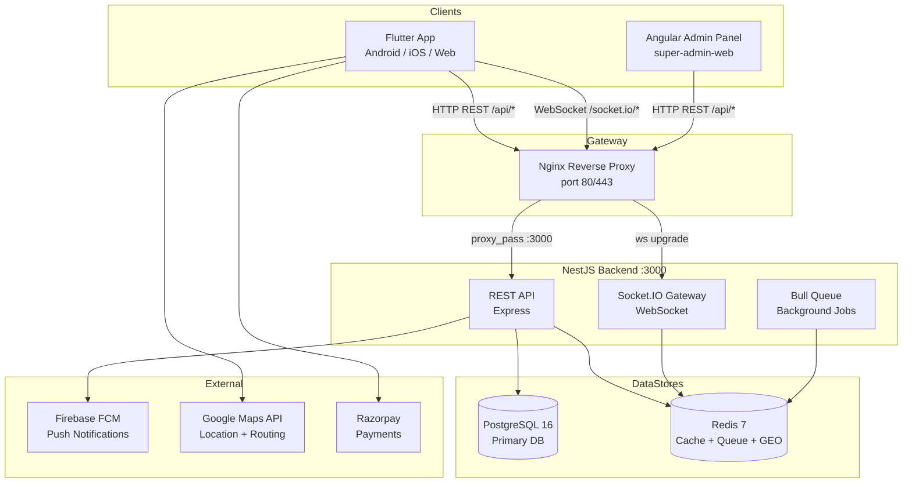
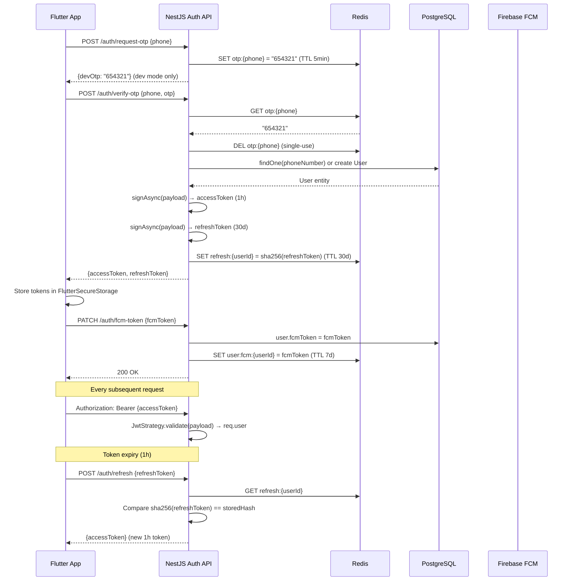
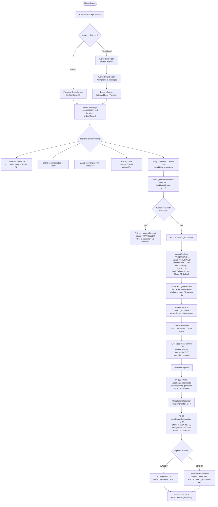
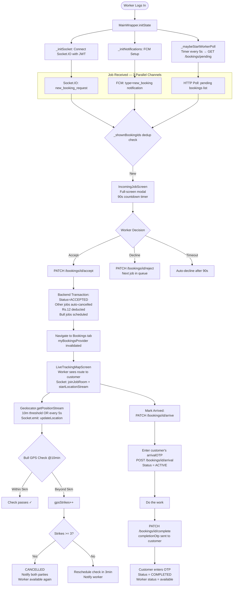
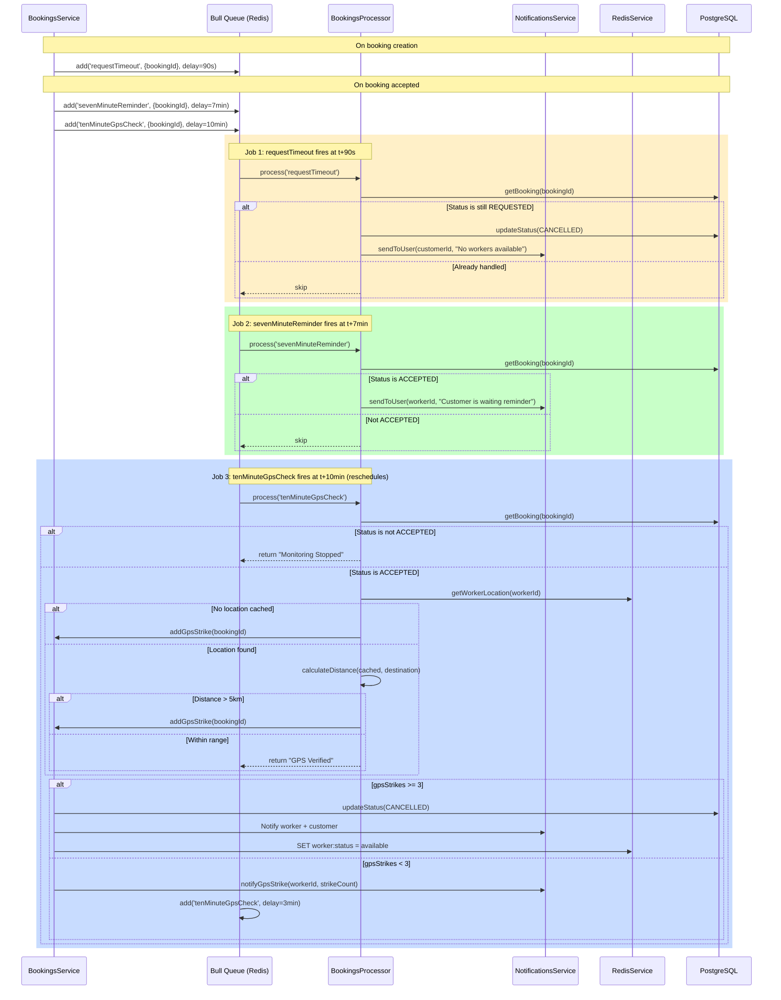
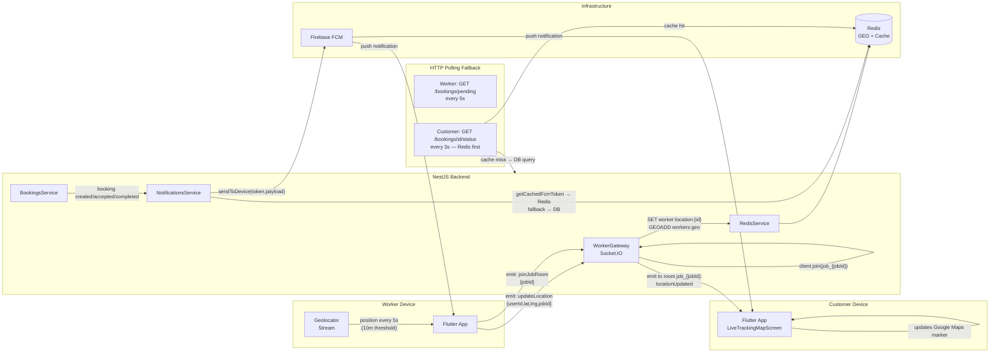
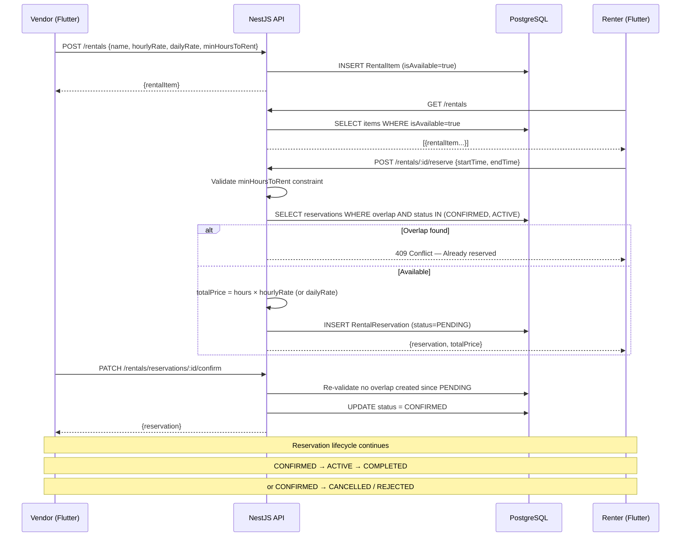
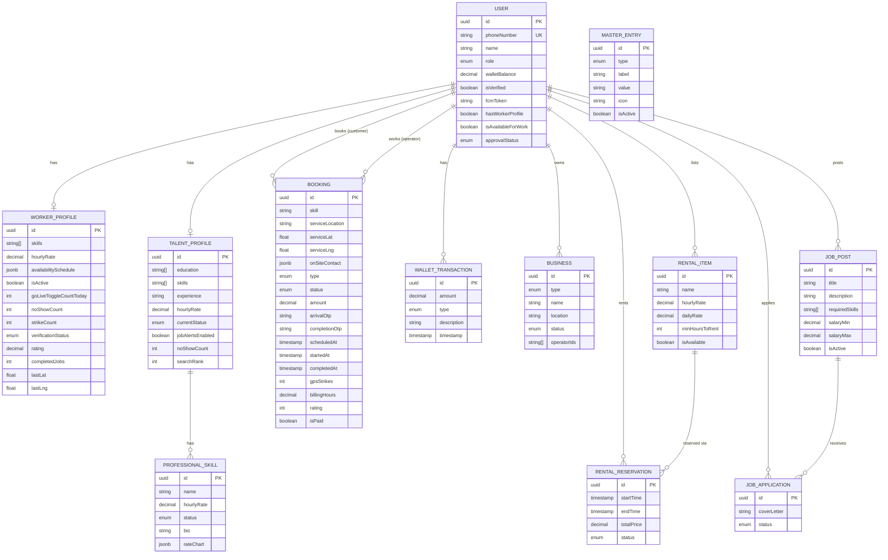
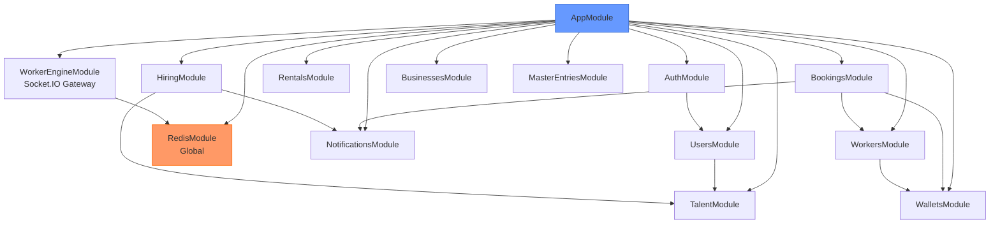

# Gixbee Platform — Complete Flow Diagrams

> Generated from full codebase analysis. All flows verified against actual service code.

---

## 1. System Architecture Overview



---

## 2. Authentication Flow



---

## 3. Customer Booking Flow — Instant Help



---

## 4. Worker Job Flow



---

## 5. Background Jobs Flow (Bull Queue)



---

## 6. Real-time Communication Flow



---

## 7. Hiring & Talent Flow

```mermaid
flowchart TD
    subgraph TalentSide["Talent Side"]
        T1[POST /talent/profile\neducation, skills, experience] --> T2[TalentProfile saved to DB]
        T2 --> T3[Redis: SADD skill:index:skillName → talentId]
        T3 --> T4[GET /hiring/jobs?skills=React]
        T4 --> T5[DB query: JobPost by requiredSkills]
        T5 --> T6[POST /hiring/jobs/id/apply\ncoverLetter]
        T6 --> T7[JobApplication: status=APPLIED]
        T7 --> T8[GET /hiring/my-applications\nTrack status in ApplicationTrackerScreen]
    end

    subgraph HRSide["HR Manager Side"]
        H1[POST /businesses\ntype=HIRING] --> H2[Business entity\nstatus=PENDING]
        H2 --> H3[Admin approves → VERIFIED]
        H3 --> H4[POST /hiring/jobs\ntitle, skills, salary range]
        H4 --> H5[JobPost: isActive=true\nFCM to matched talent]
        H5 --> H6[GET /hiring/jobs/id/applications\nHiringPipelineScreen]
        H6 --> H7[PATCH /hiring/applications/id/status]
        H7 --> H8{Status Decision}
        H8 -- INTERVIEW --> H9[Notify talent via FCM]
        H8 -- SELECTED --> H9
        H8 -- REJECTED --> H9
        H8 -- NO_SHOW --> H10[noShowCount++ on TalentProfile]
    end

    subgraph AdminSide["Admin Panel"]
        A1[GET /admin-user-list\nUsersComponent] --> A2[View talent skills\nProfessionalSkill list]
        A2 --> A3[PATCH /admin-user-list/skill/id/status]
        A3 --> A4{Skill Decision}
        A4 -- APPROVED --> A5[Skill visible in marketplace]
        A4 -- REJECTED --> A6[Skill hidden]
    end
```



---

## 8. Rental Flow



---

## 9. Admin Panel Flow

```mermaid
flowchart TD
    A([Browser: Angular App]) --> B{Auth Guard Check\nlocalStorage token?}
    B -- No token --> C[/login route\nLoginComponent]
    C --> D[POST /auth/admin-login\nusername + password]
    D --> E{Valid credentials?}
    E -- No --> F[Show error]
    E -- Yes --> G[Store accessToken in localStorage\nNavigate to /dashboard]

    B -- Has token --> G

    G --> H[LayoutComponent\nSide nav + content area]

    H --> I[DashboardComponent\nGET /admin-user-list/summary]
    I --> I1[Display: Total Users\nActive Workers\nBookings\nPending Approvals]

    H --> J[UsersComponent\nGET /admin-user-list]
    J --> J1[User table with\nname, role, phone, approval status]
    J1 --> J2[Click user → Modal]
    J2 --> J3[Show TalentProfile\n+ ProfessionalSkills table]
    J3 --> J4[PATCH /admin-user-list/id/status\nAPPROVED or REJECTED]
    J3 --> J5[PATCH /admin-user-list/skill/id/status\nAPPROVED or REJECTED]

    H --> K[MasterEntriesComponent\nGET /master-entries]
    K --> K1[Filter by type:\nCATEGORY / SERVICE / ROLE\nCONFIGURATION / BANNER]
    K1 --> K2[POST /master-entries\nCreate entry]
    K1 --> K3[PATCH /master-entries/id\nUpdate entry]
    K1 --> K4[DELETE /master-entries/id]
    K1 --> K5[POST /uploads/image\nUpload banner image]

    H --> L[BusinessesComponent\nGET /businesses]
```

---

## 10. Database Entity Relationships



---

## 11. Redis Key Map

```mermaid
mindmap
  root((Redis Keys))
    Auth
      otp:{phone}
        TTL: 5 min
        OTP login code
      otp:booking:{id}:arrival
        TTL: 24h
        Arrival gate OTP
      otp:booking:{id}:completion
        TTL: 24h
        Completion gate OTP
      refresh:{userId}
        TTL: 30 days
        SHA256 refresh token hash
    Notifications
      user:fcm:{userId}
        TTL: 7 days
        FCM device token
    Bookings
      booking:status:{id}
        TTL: 24h
        Status + OTPs JSON
      worker:pending:{workerId}
        TTL: 120s
        Sorted Set of pending booking IDs
    Workers
      worker:location:{id}
        TTL: 1h
        lat, lng, timestamp JSON
      worker:status:{id}
        TTL: 1h
        available or busy
      worker:snapshot:{id}
        TTL: 24h
        Full WorkerDTO JSON
    Discovery
      skill:index:{skillName}
        TTL: 24h
        Set of worker IDs
      workers:geo
        TTL: permanent
        Redis GEO index
```

---

## 12. Module Dependency Graph


