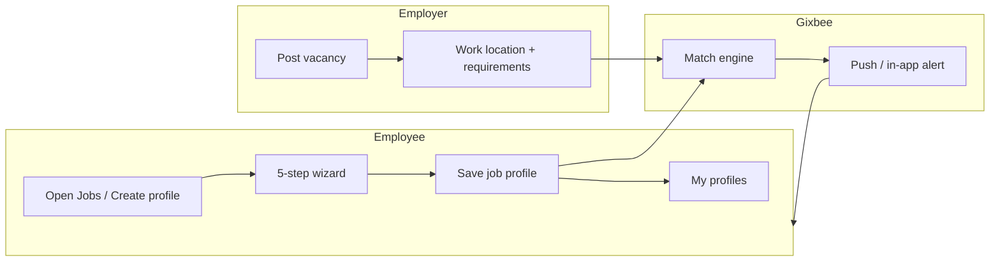

# Jobseeker (employee) — perfect Smart Hiring flow

This is the target end-to-end flow for **employees** using Gixbee Smart Hiring. It mirrors the employer **Hire Employee** taxonomy (same 18 sectors, same positions) so matching is symmetric.

**Interactive demo (single HTML file):** `jobseeker-job-profile-master.html` (identical to `seeker-job-profile-master.html`). Open in a browser; no extra `.js`.

**Employer demo:** `hire-employee-skills-master.html` · spec: `HIRE_EMPLOYEE_MASTER_FLOW.md`.

---

## 1. Big picture

- Employee builds one or more **job profiles** (e.g. Nurse · Healthcare, Electrician · Electrical).
- Employer posts a **vacancy** with **work location** (where the person reports), not “anywhere”.
- Platform notifies the employee only when the vacancy **fits** profile + **work location** rules (below).

**Not part of this flow:** Instant Help “Go Live” / hourly Pro registration — separate product.

---

## 2. Entry

| Entry | Behaviour |
| --- | --- |
| Jobs tab → **Create job profile** | Start wizard at Step 1 (new profile) |
| **My profiles** → Edit | Load saved profile; user can change any step and save again |
| **My profiles** → Create another | New profile; employment type can stay or reset |

Header **My profiles** is available on every wizard step.

---

## 3. Five-step wizard (employee)

Progress: **1/5 → 5/5**. Back goes to previous step and keeps draft. **Change** on the green chip jumps to Step 1 (sector) or Step 2 (position) without losing job type.

### Step 1/5 — Job type + sector

| UI | Rule |
| --- | --- |
| Pills: Full Time · Part Time · Intern · Contract | Single select; default Full Time |
| 18 sector tiles (same order as employer PDF) | Single select |
| Continue | Enabled only when a sector is selected |

### Step 2/5 — Position

| UI | Rule |
| --- | --- |
| Sector crumb + **Change** (back to Step 1 sector grid) | Keeps job type |
| Search | Filters positions **in this sector only** |
| Position list | One select; “Show more positions” if list is long |
| Continue | Enabled when one position is selected |

Changing position clears Step 3 types/skills for that row and rebuilds from catalogue.

### Step 3/5 — Your skills & details

Fields depend on the catalogue row (same as employer Step 3, seeker copy).

| Field | Required? |
| --- | --- |
| Type / specialization (chips; **Show more** sheet if many) | Yes — at least one |
| Qualification | Optional |
| Your experience (years) | Yes (default 2; 0 allowed) |
| Skills (suggested + Add skills sheet) | Optional but recommended |
| Languages you speak (quick chips + Add languages) | Yes — at least one |
| Short bio | Optional |

Continue blocked with toast if type or language missing.

### Step 4/5 — Work locations, pay, join date, resume

Rendered in the demo by JavaScript (`renderS4`) so fields always appear in the single HTML file.

| Field | Required? | Notes |
| --- | --- | --- |
| **Primary preferred work location** | Yes (text city/area) | Where they **want to work** — may differ from home |
| **Also willing to work in** | Optional | Comma-separated extra cities/areas |
| **Expected salary (₹/month)** | Recommended | Single amount; not min/max range |
| **Salary negotiable** | Toggle | Default on |
| **Available to join** | Yes | Immediately · Within 7 / 15 / 30 / 60 / 90 days |
| **Resume** | Optional | PDF / Word / image; upload in app to secure storage |

**Removed from this flow (by design):** “Open to relocate” toggle, fake “open roles match” counter.

### Step 5/5 — Review & save profile

| UI | Rule |
| --- | --- |
| Profile name | Optional; auto-suggested from position + sector |
| Summary | All fields; **Edit** jumps to Step 3 |
| **Save profile** | Writes profile; no payment |

### After save

| Screen | Actions |
| --- | --- |
| **Saved** | Short confirmation; **View My profiles** · **Create another profile** |
| **My profiles** | List cards; **Edit** · **Delete** · **Copy all profiles (JSON)** (demo) |

Demo storage key: `GIXBEE_JOB_PROFILES` in browser `localStorage`. Production: sync to account via `/talent/profile` (or dedicated job-profile API).

---

## 4. One profile — data captured

| Group | Stored fields |
| --- | --- |
| Meta | `id`, `displayName`, `savedAt`, `schemaVersion`, `catalogueVersion` |
| Preference | `employmentType` (code + label) |
| Taxonomy | `sector`, `position`, `types[]` |
| Person | `qualification`, `experienceYears`, `skills[]`, `languages[]`, `bio` |
| Location | `location` (primary work preference), `alsoPreferredLocations[]` |
| Pay | `salary.expectedMonthly`, `salary.negotiable` |
| Timing | `availableToJoin` (code + label) |
| Document | `resume` (optional file metadata + URL in production) |

Employee can save **multiple profiles** (different sector/position lines).

---

## 5. How employer and employee lines meet (matching)

| Party | Location field | Meaning |
| --- | --- | --- |
| **Employer** | Work location on vacancy | Shop, office, site — where work happens |
| **Employee** | Primary + also willing | Cities/areas where they accept jobs |

**Notify employee when:**

1. Employment type compatible (FT job vs FT profile, etc.).
2. Sector / position / types / skills / languages satisfy employer filters (same rules as employer post).
3. **Employer work location** matches employee **primary** OR any **also willing** entry (same city/area, or within app radius e.g. 15–25 km for on-site roles).
4. Salary expectations overlap or negotiable (product rule).
5. Join availability acceptable.

**Examples**

- Shop in Kochi posts job → only profiles with Kochi in primary or “also willing” get alerted.
- Employee lives in Kochi, primary preferred **Trivandrum**, also **Kochi** → Trivandrum jobs + Kochi shop jobs; not jobs in cities they never listed.

**Home address** is optional account data; matching uses **preferred work locations**, not residence.

---

## 6. Employer side (mirror, for one complete picture)

Employer uses the same catalogue in 5 steps: job type + sector → position → requirements → location + salary + vacancies → review + publish (packages in demo).

Employee Step 4 **preferred locations** answer employer Step 4 **work location**.

Full employer spec: `HIRE_EMPLOYEE_MASTER_FLOW.md`.

---

## 7. Production app (Flutter) — alignment checklist

Today `seeker_profile_wizard.dart` uses flat categories and map pin + radius. Target parity with this flow:

- [ ] Nested 18-sector catalogue (same as HTML / PDF)
- [ ] Position → types → skills sheets
- [ ] Primary preferred work location + **also willing** list (or map pins per city)
- [ ] Single expected monthly salary + negotiable
- [ ] Join dropdown (Immediate … 90 days) + resume upload
- [ ] Multiple saved job profiles per user
- [ ] Match notifications using employer **work location** vs employee **preferred work areas**

---

## 8. QA path (HTML demo)

1. Open `jobseeker-job-profile-master.html`.
2. Full Time → Healthcare → Nurse → General Nurse + languages → Step 4: primary Kochi, also `Thiruvananthapuram` → save.
3. **My profiles** shows card with work locations and join date.
4. Edit profile, change salary, save again (same id updates).
5. Create second profile (e.g. Electrician) — two cards in **My profiles**.

Regenerate after code changes: `python3 docs/prototypes/_gen_seeker_profile_html.py`.
